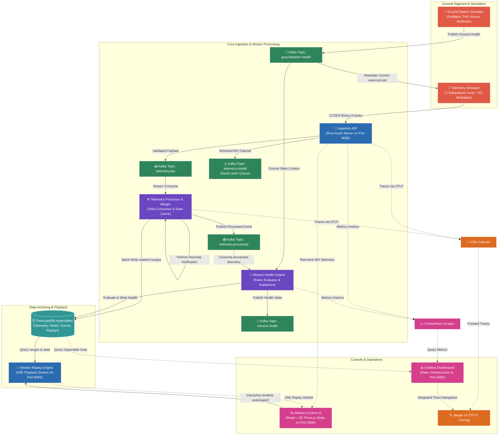

# OrbitLogs — Comprehensive Platform Evaluation & Review Report 🛰️

## 1. Executive Summary

**OrbitLogs** is a real-time, high-performance ground segment telemetry ingestion, event-driven processing, and mission control observability platform. Engineered primarily in **Rust** on the backend and **React/TypeScript** on the frontend, it provides an operations pipeline designed to monitor and control satellite constellations of thousands of Low Earth Orbit (LEO) satellites.

By utilizing a decoupled, event-driven microservices architecture backed by **Kafka (KRaft)** and **TimescaleDB**, OrbitLogs bridges the gap between modern cloud-native systems engineering and aerospace ground segments. It addresses core challenges of modern space flight operations: data ingestion reliability, state synchronization via digital twins, automated anomaly detection, and real-time situational awareness.

This document serves as an exhaustive review of the platform, details its architecture, explains its targeted aerospace domain, outlines recently remediated vulnerabilities, and highlights technical debt and future engineering opportunities.

---

## 2. Platform Architecture & Data Flow

OrbitLogs models a modern, space-grade ground station telemetry and command pipeline. Below is the architectural diagram mapping data paths through the system:

### Core Data-Flow Pipeline:
1. **CCSDS packet parsing**: Telemetry streams are downlinked from on-orbit simulators in spaceops-packets-defined binary envelopes. Corrupt or unauthenticated packets are shunted into the Dead Letter Queue (DLQ).
2. **Kafka Event Bus**: Validated payloads populate the `telemetry.raw` topic on a 3-node Kafka KRaft cluster.
3. **Telemetry Processor**: Consumes raw packets, runs localized anomaly checks, stores updates in an in-memory LRU cache, updates TimescaleDB, and publishes consolidated events to `telemetry.processed`.
4. **Mission Health Engine**: Evaluates current system health parameters, updates constellation risk scores, and routes metrics to Alertmanager and Grafana.
5. **Mission Command uplink**: High-priority operator commands are cryptographically verified and sent to Kafka `command.events` to modulate active spacecraft simulators.

---

## 3. Detailed Component Breakdown

OrbitLogs consists of **11 application services** and **5 shared crates**:

### Backend Application Services (Cargo Workspace members):
1. **Telemetry Ingestion API** ([apps/telemetry-collector](file:///c:/Users/bikrams/orbitlogs/OrbitLOgs/apps/telemetry-collector)): Handles HTTP/WebSocket data capture. Supports CCSDS binary packets and enforces schema boundaries.
2. **Telemetry Processor** (compiled into the same binary as collector): A Tokio-backed async event consumer that ingests raw telemetry from Kafka, validates checksums, and batches writes to TimescaleDB.
3. **Telemetry Simulator** ([apps/telemetry-simulator](file:///c:/Users/bikrams/orbitlogs/OrbitLOgs/apps/telemetry-simulator)): Simulates a LEO satellite's 7 subsystems (Power, TCS, TTC, PROP, ADCS, Payload, OBC) including state correlations (e.g. thermal load causing computer throttling).
4. **Ground Station Simulator** ([apps/ground-station-simulator](file:///c:/Users/bikrams/orbitlogs/OrbitLOgs/apps/ground-station-simulator)): Models polar ground station coordinates and modulates communications attenuation, rain fade, pass geometries, and hardware faults.
5. **Mission Health Engine** ([apps/mission-health-engine](file:///c:/Users/bikrams/orbitlogs/OrbitLOgs/apps/mission-health-engine)): Evaluates fleet risk scores and parses hardware anomaly rules.
6. **Mission Replay Engine** ([apps/mission-replay-engine](file:///c:/Users/bikrams/orbitlogs/OrbitLOgs/apps/mission-replay-engine)): Implements a Server-Sent Events (SSE) timeline scrubber allowing operators to playback historical telemetry windows at up to 100x speed.
7. **Mission Command Service** ([apps/mission-command-service](file:///c:/Users/bikrams/orbitlogs/OrbitLOgs/apps/mission-command-service)): Manages command schedules and executes state transitions under operator/director role access checks.
8. **Digital Twin Engine** ([apps/digital-twin-engine](file:///c:/Users/bikrams/orbitlogs/OrbitLOgs/apps/digital-twin-engine)): Holds virtual memory twins of the constellation, projects hardware lifetimes, and supports runtime failure injections.
9. **Mission Timeline Service** ([apps/mission-timeline](file:///c:/Users/bikrams/orbitlogs/OrbitLOgs/apps/mission-timeline)): Consolidates log outputs and timelines across all nodes into TimescaleDB.
10. **AI Incident Commander** ([apps/ai-incident-commander](file:///c:/Users/bikrams/orbitlogs/OrbitLOgs/apps/ai-incident-commander)): An AI-enabled ground operations co-pilot integrating Gemini API for anomaly diagnoses, postmortems, and runbook explainers.
11. **Constellation Simulator** ([apps/constellation-simulator](file:///c:/Users/bikrams/orbitlogs/OrbitLOgs/apps/constellation-simulator)): Mass load generator capable of modeling state metrics for up to 5,000 active assets.

### Crates (Shared Libraries):
- **spaceops-models** ([crates/spaceops-models](file:///c:/Users/bikrams/orbitlogs/OrbitLOgs/crates/spaceops-models)): Core database schemas, connection managers, migrations, and shared cryptography structures.
- **spaceops-packets** ([crates/spaceops-packets](file:///c:/Users/bikrams/orbitlogs/OrbitLOgs/crates/spaceops-packets)): Low-level byte serializer, CCSDS header layouts, and CRC-16 checks.
- **space-schema-registry** ([crates/space-schema-registry](file:///c:/Users/bikrams/orbitlogs/OrbitLOgs/crates/space-schema-registry)): Manages runtime schema compatibility validations (V1/V2/V3).
- **fleet-health** ([crates/fleet-health](file:///c:/Users/bikrams/orbitlogs/OrbitLOgs/crates/fleet-health)): Diagnostic arithmetic structures for fleet reliability scoring.
- **space-otel-collector** ([crates/space-otel-collector](file:///c:/Users/bikrams/orbitlogs/OrbitLOgs/crates/space-otel-collector)): Bridges Kafka events directly into OTel tracing and Prometheus-readable metrics.

---

## 4. Targeted Space Tech Domain

OrbitLogs is positioned in the **Ground Segment & Spacecraft Operations (Ops)** domain of space technology. It is specifically designed to meet the demands of **LEO mega-constellations** (such as SpaceX Starlink, OneWeb, or Amazon Project Kuiper).

The platform addresses four specialized space segment demands:

### 1. High-Frequency Downlink Telemetry Ingestion
LEO satellites pass ground stations in fleeting windows (~8-15 minutes). Telemetry pipelines must ingest bursty, high-volume telemetry frames. OrbitLogs implements a memory-safe Rust ingestion layer connected to Kafka queues, ensuring that ground receivers do not drop critical downlinked payload packets.

### 2. Multi-Tier Command Verification (Uplink)
Inadvertent commands (e.g. initiating thruster fire in safe mode) can cause mission loss. OrbitLogs addresses this by implementing a structured command lifecycle:
$$\text{CREATED} \rightarrow \text{APPROVED} \rightarrow \text{QUEUED} \rightarrow \text{TRANSMITTED} \rightarrow \text{RECEIVED} \rightarrow \text{VERIFIED}$$
It enforces Role-Based Access Control (RBAC), requiring **Flight Director** authorization for critical commands while allowing **Operators** to issue routine health inquiries.

### 3. Space Situational Awareness (SSA) & Pass Modulations
OrbitLogs models polar ground station passes. It accounts for atmospheric attenuation (rain, storms) and signal degradation (low elevation RSSI dropout), simulating real-world packet losses that ground operations engineers must handle.

### 4. Telemetry Replays and Hard Failure Postmortems
When a satellite experiences anomalous behavior on orbit, operators must analyze chronological telemetry leading up to the fault. The **Mission Replay Engine** provides timeline seek queries that can playback telemetry chronologically to help engineers diagnose and prevent cascading hardware failures.

---

## 5. Security & Architectural Hardening (Remediated Gaps)

A SpaceX-level design review of the platform identified several security and reliability vulnerabilities. These have been remediated in the codebase as follows:

### 🔒 Cryptographic and Authentication Hardening
- **Timing Attacks Prevented**: Centralized constant-time comparison in [spaceops-models::auth::secure_compare](file:///c:/Users/bikrams/orbitlogs/OrbitLOgs/crates/spaceops-models/src/auth.rs). Both keys are preprocessed using SHA-256 before comparison with the `subtle` crate, mitigating timing side-channels that leak API key lengths. Duplicated copies were removed from all microservices.
- **Decoupled Key Management**: Separated JWT token signing keys from backend service API keys. If an API key is logged or compromised, the JWT keys remain safe. Added CLI `--jwt-secret`, environment variable `JWT_SECRET`, and Docker secrets file inputs.
- **Login Rate-Limiting**: Integrated concurrent lock-free token-bucket rate limiting on the `/api/auth/login` route in [apps/mission-command-service/src/auth.rs](file:///c:/Users/bikrams/orbitlogs/OrbitLOgs/apps/mission-command-service/src/auth.rs) to prevent brute-force credential stuffing.
- **AI Prompt Injection Guardrails**: Configured strict role boundaries and sandboxing guidelines in the [apps/ai-incident-commander/src/main.rs](file:///c:/Users/bikrams/orbitlogs/OrbitLOgs/apps/ai-incident-commander/src/main.rs) system prompt to prevent operator input from leaking proprietary system manuals.

### ⚙️ Transport and Database Integrity
- **Kafka mutual TLS (mTLS)**: Configured internal Kafka listeners to use the `SSL` protocol with `ssl.client.auth=required` in [docker-compose.yml](file:///c:/Users/bikrams/orbitlogs/OrbitLOgs/deployments/docker-compose/docker-compose.yml). Dynamic bootstrapping of a local CA, PKCS12 keystores/truststores, and PEM client keys is orchestrated inside a Docker-native container (`certs-generator`).
- **Version-Tracked DB Migrations**: Replaced brittle database shell scripts with programmatic migrations. The `"migrate"` feature on `sqlx` is enabled in `Cargo.toml`, executing schema changes during startup inside [crates/spaceops-models/src/db.rs](file:///c:/Users/bikrams/orbitlogs/OrbitLOgs/crates/spaceops-models/src/db.rs) with lock coordination.
- **Client FD Leak Prevention**: Refactored the AI Incident Commander to initialize and reuse a single `reqwest::Client` in `AppState` for TCP socket pooling, preventing file descriptor exhaustion under load.
- **Database OOM Safeguard**: Added column selections and pagination (limit/offset variables) to commands endpoints in [apps/mission-command-service/src/commands.rs](file:///c:/Users/bikrams/orbitlogs/OrbitLOgs/apps/mission-command-service/src/commands.rs).

### 📈 Observability & Quality Assurance
- **Kafka Consumer Lag Alerting**: Added a `HighConsumerLag` Prometheus warning rule in [rules.yml](file:///c:/Users/bikrams/orbitlogs/OrbitLOgs/deployments/prometheus/rules.yml) alerting when partitions fall behind by more than 1000 messages, protecting against silent processing failures.
- **Digital Twin Subsystem Tests**: Created unit tests verifying battery degradation, radiator alignment drift, thermal bounds, and fuel alerts in [apps/digital-twin-engine/src/main.rs](file:///c:/Users/bikrams/orbitlogs/OrbitLOgs/apps/digital-twin-engine/src/main.rs).

---

## 6. Shortcomings & Technical Debt

Despite the security hardening, the platform has several design constraints that require engineering remediation before it can support production LEO operations:

### 1. Ingestion and Processing Coupling
- **Description**: The `telemetry-collector` runs the HTTP server and the Kafka processing loop in a single process.
- **Critique**: Telemetry ingestion is bursty (aligned with ground passes), while database consumption is latency-buffered. Coupling them prevents independent scaling. A production deployment should split the collector into two distinct processes: an ingestion edge proxy and a telemetry processing worker pool.

### 2. Mock Latency and Command Verification Loops
- **Description**: Spacecraft state transitions (e.g. from `TRANSMITTED` to `RECEIVED`) rely on synthetic timers (`tokio::time::sleep(Duration::from_secs(2))`).
- **Critique**: Real-world operations verify command executions via telemetry downlink matches. A command is only marked `RECEIVED` or `VERIFIED` when the spacecraft downlinks telemetry containing execution confirmation bytes. The current simulator bypasses this feedback loop.

### 3. Kubernetes Infrastructure Completeness
- **Description**: Kubernetes manifests are provided for only 6 of the 11 microservices. Configs are missing for newer services like `mission-command-service`, `digital-twin-engine`, and `ai-incident-commander`.
- **Critique**: The platform lacks production-grade Kubernetes manifests, such as PodDisruptionBudgets, network security policies, and resource limit profiles across all services.

### 4. TimescaleDB Query Aggregation
- **Description**: Subsystem telemetry averages are computed at query time over raw tables.
- **Critique**: Running telemetry calculations directly against the hypertables will degrade query performance under mass fleet simulator loads. The system needs **TimescaleDB Continuous Aggregates** (materialized roll-ups computed in 1-minute or 5-minute increments) to speed up frontend graph loads.

---

## 7. Future Improvement & Scaling Scope

To advance OrbitLogs to an enterprise-grade spacecraft operations platform, the following features are recommended for implementation:

### 🛰️ Space Domain Extensions
- **Orbital Propagation (SGP4/SDP4)**: Integrate the `sgp4` Rust crate. Instead of using raw synthetic mock coordinates, the simulator could ingest standard Two-Line Element (TLE) datasets from Space-Track to propagate satellite position vectors, reflecting mathematically precise orbits.
- **Geometric Pass Calculator**: Implement orbital geometry calculations. Telemetry downlinks should only activate when a satellite's line of sight intersects a ground station's minimum antenna elevation limit, replacing the randomized simulated passes.
- **Multi-Tenant Partitioning**: Extend database schemas and authorization context to partition operations by a `mission_id` or `operator_id` key, ensuring commercial satellite operators can only command their own assets.

### ⚙️ Systems Engineering & Ops Scaling
- **Autoscaling via Consumer Group Lag**: Configure the Kubernetes Horizontal Pod Autoscaler (HPA) using custom Prometheus adapter metrics. This scales telemetry consumer pods up or down based on Kafka queue lag ($\text{lag} > 10000$ messages) instead of generic CPU limits.
- **Performance Benchmarking**: Integrate `criterion` in Rust crates to benchmark serialization bottlenecks, comparing CCSDS binary deserialization speeds to standard JSON processing.
- **Unified Helm Chart**: Bundle all 11 microservices, TimescaleDB schema configs, Kafka security certs, Grafana dashboards, and Alertmanager routing into a unified Helm chart to simplify staging and production deployments.

---

## 8. Conclusion

OrbitLogs is a highly performant, well-architected framework for satellite constellation monitoring. Its choice of **Rust** ensures zero-overhead runtime safety and low memory usage. The integration of **Kafka** handles decoupling, while **TimescaleDB** handles time-series database requirements. 

Through recent hardening efforts (mTLS transport security, timing-attack mitigation, centralized migrations, and client connection reuse), the core architecture has been elevated close to production-grade ground segments. Addressing the remaining technical debt—specifically decoupling ingestion from consumers, implementing true closed-loop telemetry command validation, and unifying deployment manifests—will make OrbitLogs a production-grade framework for modern satellite operations.
