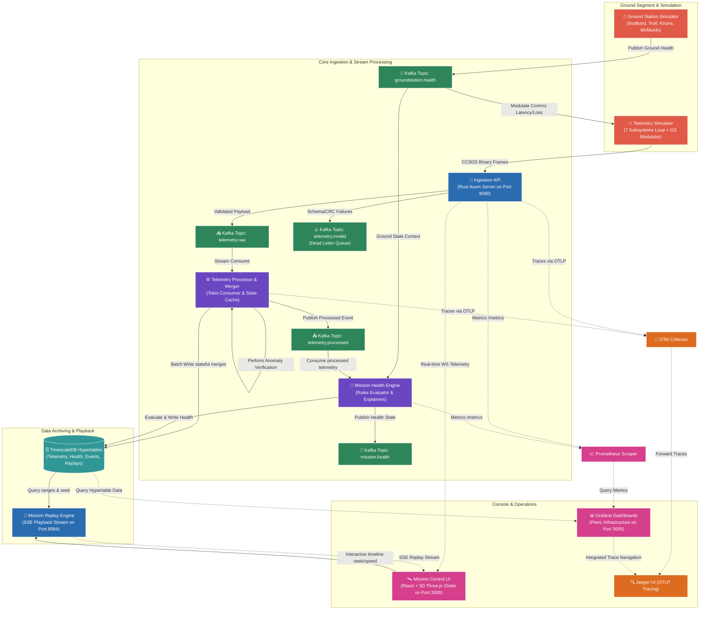

# OrbitLogs 🚀

[](https://github.com/sarkarbikram90/OrbitLogs/actions/workflows/ci.yml)
[](https://www.rust-lang.org/)
[](https://www.typescriptlang.org/)
[](https://www.timescale.com/)
[-green.svg)](https://kafka.apache.org/)
[](https://opentelemetry.io/)
[](https://threejs.org/)
[](https://www.docker.com/)
[](LICENSE)
[](CONTRIBUTING.md#developer-certificate-of-origin-dco)
[](https://bestpractices.coreinfrastructure.org/)
[](GOVERNANCE.md)


> **Real-Time Spacecraft Telemetry & Mission Control Observability Platform**

OrbitLogs is a production-grade, high-performance real-time satellite telemetry ingestion, stream processing, historical replay, and 3D visualization platform. Built entirely with Rust, React, and TypeScript, and designed with decoupled event-driven microservice principles, OrbitLogs demonstrates how modern Site Reliability Engineering (SRE), Cloud Native Computing Foundation (CNCF) frameworks, and OpenTelemetry standards can monitor, troubleshoot, and analyze satellite fleets orbiting Earth.

---

## 🏛️ CNCF Sandbox Project Alignment

OrbitLogs is designed from the ground up to comply with the **Cloud Native Computing Foundation (CNCF)** Sandbox criteria:

1. **Vendor Neutrality**: Governed by open, meritocratic community processes as detailed in [GOVERNANCE.md](GOVERNANCE.md).
2. **Open Source Licensing**: Fully licensed under the [Apache License, Version 2.0](LICENSE). Standard Apache header notices are included across all codebase source files.
3. **Developer Certificate of Origin (DCO)**: Commit provenance is verified on every pull request via DCO (`git commit -s`), as detailed in [CONTRIBUTING.md](CONTRIBUTING.md).
4. **Cloud-Native Native Ecosystem Integration**: Built with native support for OpenTelemetry (OTLP), Prometheus metrics, Kafka KRaft event streaming, and Kubernetes deployment targets.
5. **OpenSSF Security Compliance**: Adheres to responsible disclosure policies in [SECURITY.md](SECURITY.md) and strict supply chain verification.

---

## 🌌 Core Philosophy & Significance

Traditional satellite ground segment software has historically relied on monolithic, closed-source, or legacy proprietary monitoring software. OrbitLogs bridges the gap between modern cloud-native software engineering and aerospace mission control by applying **Site Reliability Engineering (SRE)** and **Observability Engineering** principles to space systems:

*   **Subsystem-Level Observability**: Satellites are not treated as monolithic black boxes. Telemetry is parsed, processed, and tracked across individual spacecraft subsystems (EPS, TCS, TTC, PROP, ADCS, Payload, OBC).
*   **Time-Series Replay ("What Happened?")**: Operators can scrub back through timeline history at up to 100x speed to analyze complex failure cascades and conduct postmortems.
*   **Space-to-Ground Physics Modulations**: Communications latency, signal strength, and packet loss are dynamically simulated using real-world link budgets, weather states, and ground segment health parameters.
*   **Zero-Loss Engineering**: Memory safety guarantees in Rust combined with manual Kafka offset commits guarantee at-least-once delivery of mission-critical state data.

---

## 🛠️ System Architecture

The decoupled, event-driven architecture of OrbitLogs enables low-latency telemetry processing and horizontal microservice scalability.



---

## 🚀 Microservices & Shared Libraries

OrbitLogs consists of **26 workspace components** (17 application services + 7 shared library crates + 2 utility crates):

### Applications (`apps/`)

1. **[telemetry-collector](apps/telemetry-collector)**: Edge HTTP/binary telemetry ingestion gateway.
2. **[telemetry-simulator](apps/telemetry-simulator)**: 7-subsystem satellite telemetry stream generator.
3. **[ground-station-simulator](apps/ground-station-simulator)**: Polar ground station link budget modulator.
4. **[mission-health-engine](apps/mission-health-engine)**: Rules-based health score & anomaly evaluator.
5. **[mission-replay-engine](apps/mission-replay-engine)**: High-speed historical telemetry timeline scrub/SSE server.
6. **[mission-command-service](apps/mission-command-service)**: RBAC-gated spacecraft command lifecycle manager.
7. **[digital-twin-engine](apps/digital-twin-engine)**: Synchronized virtual satellite state & failure injector.
8. **[mission-timeline](apps/mission-timeline)**: Unified event aggregator & TimescaleDB indexer.
9. **[ai-incident-commander](apps/ai-incident-commander)**: RAG operational diagnostic copilot powered by Gemini/OpenAI.
10. **[constellation-simulator](apps/constellation-simulator)**: Concurrent state generator for 5,000+ satellites.
11. **[orbit-ops-service](apps/orbit-ops-service)**: Space Traffic Management (STM), conjunction risk scoring & 3D debris visualization.
12. **[space-otel-collector](apps/space-otel-collector)**: OpenTelemetry metrics transformation exporter (`/metrics`).
13. **[contact-window-predictor](apps/contact-window-predictor)**: Orbital pass predictor using SGP4 line-of-sight elevation geometry.
14. **[constellation-scheduler](apps/constellation-scheduler)**: Optimization engine for ground terminal task allocation.
15. **[orbit-determination-service](apps/orbit-determination-service)**: Extended Kalman Filter (EKF) state estimator with J2 perturbation modeling.
16. **[autonomous-mission-planning](apps/autonomous-mission-planning)**: HTN command sequence planner with digital twin validation.
17. **[mission-control-ui](apps/mission-control-ui)**: React + Three.js 3D earth track mission control console.

### Shared Crates (`crates/`)

- **[orbitlogs-astrodynamics](crates/orbitlogs-astrodynamics)**: SGP4 orbital propagation & ECI/ECEF/ENU coordinate frame transformations.
- **[orbitlogs-models](crates/orbitlogs-models)**: Core domain structures (`TelemetryRecord`, `Command`, `HealthAssessment`).
- **[orbitlogs-packets](crates/orbitlogs-packets)**: CCSDS binary frame parser & CRC-16-CCITT checksum validator.
- **[orbitlogs-propulsion](crates/orbitlogs-propulsion)**: Tsiolkovsky rocket equation & $\Delta v$ maneuver fuel calculators.
- **[fleet-health](crates/fleet-health)**: Constellation readiness, availability, and cumulative risk scoring.
- **[space-schema-registry](crates/space-schema-registry)**: V1/V2/V3 telemetry payload schema compatibility validator.
- **[orbitlogs-test-utils](crates/orbitlogs-test-utils)**: Centralized test fixture factories and mock generators.

---

## 📊 OpenTelemetry Standards & Compliance

OrbitLogs strictly adheres to official **OpenTelemetry (OTel)** standards:

*   **W3C Context Propagation**: Uses `TraceContextPropagator` to inject and extract `traceparent` headers across asynchronous Kafka streams.
*   **OTLP Exporter Pipeline**: Exports spans asynchronously using `opentelemetry_otlp` via gRPC to OTLP receivers on port `4317`.
*   **Production SDK Tracing**: Utilizes non-blocking `BatchSpanProcessor` with `tokio` runtime execution.
*   **Semantic Conventions**: Complies with OTel semantic conventions for `service.name`, `telemetry.sdk`, and HTTP attributes.
*   **Prometheus Metrics**: Exposes aggregated metrics at `/metrics` (port `8091`), compatible with Prometheus and OTel scrapers.

---

## 🔌 Port Mapping & Developer Interfaces

| Service / Interface | Port | Protocol | Description |
| :--- | :--- | :--- | :--- |
| **Mission Control Console** | `3000` | HTTP | Live operations frontend & 3D orbit visualization |
| **Telemetry Ingestion API** | `8080` | HTTP/WS | Telemetry binary/JSON ingestion & live WS streams |
| **Telemetry Simulator** | `8081` | HTTP | Simulator telemetry generator metrics |
| **Mission Health Engine** | `8082` | HTTP | Health score rules metrics exporter |
| **Ground Station Simulator** | `8083` | HTTP | Link budget metrics exporter |
| **Mission Replay Engine** | `8084` | HTTP/SSE | Replay controls and Server-Sent Events stream |
| **Mission Command Service** | `8085` | HTTP | RBAC command lifecycle control |
| **Digital Twin Engine** | `8086` | HTTP | Virtual satellite states & failure injector |
| **Mission Timeline Engine** | `8087` | HTTP | Event aggregator and timeline database search |
| **AI Incident Commander** | `8088` | HTTP | Operations Gemini RAG co-pilot |
| **Constellation Simulator** | `8089` | HTTP | High-efficiency constellation state loop |
| **Space OTel Collector** | `8091` | HTTP | OpenTelemetry metrics mapping scraper |
| **Orbit Operations & STM Service** | `8095` | HTTP | Space Traffic Management & Conjunction Assessment API |
| **Contact Window Predictor** | `8096` | HTTP | Ground station access window prediction service |
| **Constellation Scheduler** | `8097` | HTTP | Communication task scheduling & optimization |
| **Orbit Determination Service** | `8098` | HTTP | Extended Kalman Filter orbit estimation |
| **Autonomous Mission Planning** | `8099` | HTTP | HTN command sequence planner |
| **TimescaleDB (Postgres)** | `5432` | TCP | Hypertable telemetry, command audits, and events |
| **Prometheus** | `9090` | HTTP | Ingestion metrics database & scrapers |
| **Grafana** | `3005` | HTTP | Fleet and SRE infrastructure dashboard |
| **Jaeger UI** | `16686` | HTTP | Distributed tracing dashboard |

---

## 🛠️ Quick Start

### Prerequisites
*   **Docker** & **Docker Compose**
*   **Rust (v1.82+)**
*   **Node.js (v20+)** (for UI development)

### Launch Infrastructure & Services
Run the automated bootstrap script:

```bash
# Set script permissions
chmod +x scripts/*.sh

# Run the bootstrap sequence
./scripts/bootstrap.sh
```

Navigate to [http://localhost:3000](http://localhost:3000) to access the **Mission Control Console**.

---

## 🧪 Testing & Quality Gates

Run workspace-wide test suites:

```bash
# Run unit and integration tests across all workspace crates
cargo test --all-targets --all-features
```

Verify frontend client compilation:

```bash
cd apps/mission-control-ui
npm run build
```

---

## 🤝 Community Governance & Contributing

OrbitLogs welcomes community contributions! Please review our community governance documents:

*   **[CONTRIBUTING.md](CONTRIBUTING.md)**: Developer guide, DCO sign-off rules, formatting, and PR submission guidelines.
*   **[GOVERNANCE.md](GOVERNANCE.md)**: Technical Steering Committee structure, voting rules, and maintainer onboarding.
*   **[CODE_OF_CONDUCT.md](CODE_OF_CONDUCT.md)**: CNCF Code of Conduct pledge and reporting procedures.
*   **[SECURITY.md](SECURITY.md)**: Vulnerability disclosure policy and security response timelines.
*   **[MAINTAINERS.md](MAINTAINERS.md)**: Active project maintainers list and contact information.
*   **[ADOPTERS.md](ADOPTERS.md)**: Roster of organizations evaluating or deploying OrbitLogs.
*   **[ROADMAP.md](ROADMAP.md)**: Short-term, medium-term, and long-term technical goals.

---

## ⚖️ License

OrbitLogs is licensed under the [Apache License, Version 2.0](LICENSE). Copyright © OrbitLogs Authors.
