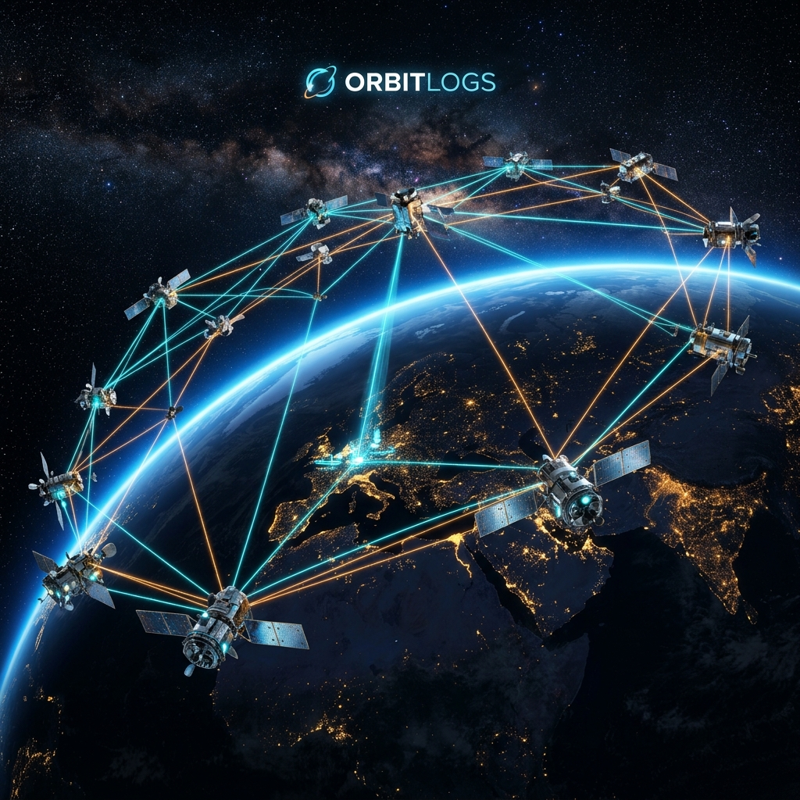
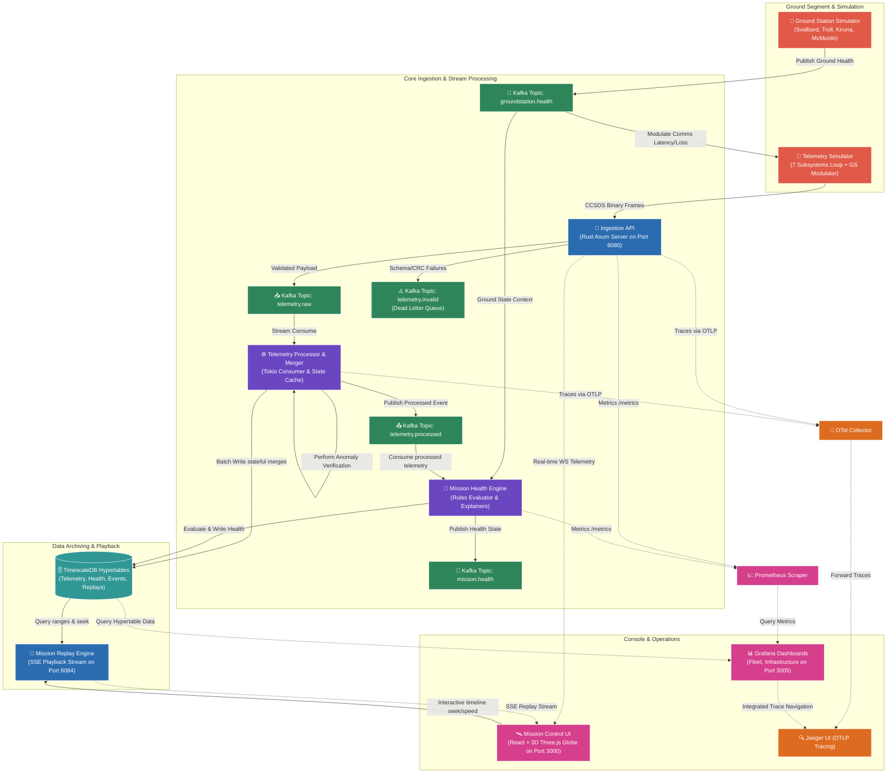

# OrbitLogs 🚀

[](https://github.com/sarkarbikram90/OrbitLogs/actions/workflows/ci.yml)
[](https://www.rust-lang.org/)
[](https://www.typescriptlang.org/)
[](https://www.timescale.com/)
[-green.svg)](https://kafka.apache.org/)
[](https://crates.io/crates/subtle)
[](https://opentelemetry.io/)
[](https://threejs.org/)
[](https://www.docker.com/)
[](#⚡-recent-production--security-hardening)
[](LICENSE)





> **Real-Time Spacecraft Telemetry & Mission Control Observability Platform**

OrbitLogs is a production-grade, highly performant real-time satellite telemetry ingestion, processing, replay, and visualization platform. Built entirely with Rust, React, and TypeScript, and designed with decoupled event-driven principles, it demonstrates how contemporary SRE, platform, and observability frameworks can monitor, troubleshoot, and analyze large-scale satellite fleets orbiting Earth.

---

## 🌌 Core Philosophy & Significance

Traditional satellite ground segment systems have historically relied on monolithic, closed-source, or outdated legacy monitoring software. OrbitLogs bridges the gap between modern cloud-native software engineering and aerospace operations by applying **Site Reliability Engineering (SRE)** and **Observability Engineering** principles to space missions:
*   **Subsystem-Level Observability**: Satellites are not treated as black boxes. Telemetry is parsed, processed, and tracked at the individual spacecraft subsystem level.
*   **Time-Series Replay ("What Happened?")**: Operators can scrub back through timeline history at up to 100x speed to analyze complex failure cascades and conduct postmortems.
*   **Space-to-Ground Physics Modulations**: Communications latency, signal strength, and packet loss are dynamically simulated using real-world link budgets, weather states, and ground segment health parameters.
*   **Zero-Loss Engineering**: Built using Rust's memory safety guarantees and manual Kafka offset commits to guarantee at-least-once delivery of mission-critical state data.

---

## 🛠️ System Architecture

The decoupled, event-driven architecture of OrbitLogs enables low-latency telemetry processing and high scalability.



---

## 🚀 Key Technical Features & Services

OrbitLogs 2.0 introduces a decentralized suite of async Rust microservices and premium visualization panels representing a complete telemetry, command, and diagnostics ground operations architecture.

### 1. Onboard Spacecraft Subsystems Modeling
*   Emits independent telemetry streams from **7 core subsystems**:
    1.  **Power (EPS)**: Battery voltage, currents, and solar array output metrics.
    2.  **Thermal Control (TCS)**: Onboard core CPU temperatures.
    3.  **Communications (TTC)**: Signal strength (RSSI), packet loss, and transmission latency.
    4.  **Propulsion (PROP)**: Fuel capacity, altitude, and current velocity.
    5.  **ADCS (Attitude Determination & Control)**: Orientation pitch, roll, and yaw angles.
    6.  **Payload**: Instrument activity state and power draw levels.
    7.  **Flight Computer (OBC)**: CPU load and memory usage metrics.
*   Physical side-effects are dynamically propagated across subsystems (e.g., thermal spikes trigger CPU throttling, causing ADCS control degradation; battery depletion causes payload safety shutdowns).

### 2. Ground Station Link Modulator
*   Simulates four main polar ground stations: **Svalbard (GS-0001)**, **Troll (GS-0002)**, **Kiruna (GS-0003)**, and **McMurdo (GS-0004)**.
*   Injects real-time orbital pass factors including signal degradation, antenna mechanical faults, backhaul network congestion, and atmospheric weather states (storms, heavy snow).

### 3. CCSDS-Inspired Binary Telemetry Layer
*   Uses [crates/orbitlogs-packets](crates/orbitlogs-packets) to enforce structured binary serialization (`application/octet-stream`).
*   Implements a custom **CRC-16-CCITT checksum validation** to reject corrupt packets during ground segment uplink, maintaining a JSON fallback endpoint for open integrations.

### 4. Space Schema Registry (`crates/space-schema-registry`)
*   Manages version compatibility checking (Backward, Forward, Full) for spacecraft telemetry payloads.
*   Supports runtime schema validation for **V1 (Legacy)**, **V2 (Standard)**, and **V3 (Extended)** telemetry packets, ensuring seamless data format migrations without ingestion outages.

### 5. Fleet Health Engine (`crates/fleet-health`)
*   Aggregates health states across all active assets.
*   Calculates key operations indicators:
    *   **Fleet Readiness**: Mission-readiness percentages based on active payload schedules.
    *   **Subsystem Availability**: Redundant equipment state analysis.
    *   **Risk Score**: Cumulative degradation scoring incorporating thermal stress and battery aging.
    *   **Capacity & Utilization**: Propellant reserves and flight computer throughput metrics.

### 6. Space OTel Collector (`crates/space-otel-collector`)
*   Consumes raw telemetry, commands, and ground station logs from Kafka streams.
*   Converts events into unified OpenTelemetry Metrics, Spans, and Logs. Exposes a standard Prometheus scrape endpoint `/metrics` on port `8091`.

### 7. Mission Command Service (`apps/mission-command-service`)
*   Exposes secure endpoints (Port `8085`) to create, approve, queue, and execute spacecraft commands.
*   Enforces Role-Based Access Control (RBAC):
    *   **Operator**: Can create commands, queue them, and trigger transmissions.
    *   **Flight Director**: Gated authorization required to approve critical commands (e.g., safe mode, orbit burns).
*   Tracks full execution lifecycle: `CREATED` -> `APPROVED` -> `QUEUED` -> `TRANSMITTED` -> `RECEIVED` -> `VERIFIED`/`FAILED`.
*   Publishes audit trails linked directly to OpenTelemetry Trace IDs.

### 8. Digital Twin Engine (`apps/digital-twin-engine`)
*   Maintains synchronized in-memory virtual states (Port `8086`) for the entire constellation by consuming `telemetry.processed`.
*   Calculates predictive diagnostics and expected hardware lifecycle durations.
*   Features a **Failure Simulator** allowing operators to inject artificial subsystem faults (e.g., ADCS guidance drift, solar panel blockages) to evaluate operator response times and RAG automated diagnoses.

### 9. Mission Timeline (`apps/mission-timeline`)
*   Consolidates events, state transitions, and anomaly logs into a TimescaleDB unified table (Port `8087`).
*   Exposes high-speed historical search, severity filtering, and correlation analysis APIs.

### 10. AI Incident Commander (`apps/ai-incident-commander`)
*   AI Operations Assistant (Port `8088`) integrating Gemini/OpenAI RAG.
*   Correlates real-time telemetry anomalies, past command audits, and operational manuals to compile incident postmortems, root-cause analyses, and recommended recovery procedures.
*   Includes a robust, local rule-based diagnostic engine fallback if external LLM APIs are offline.

### 11. Constellation Simulator (`apps/constellation-simulator`)
*   High-efficiency constellation loop (Port `8089`) capable of generating concurrent states for up to **5,000 satellites**.
*   Simulates orbit degradation, battery capacity decay, and hardware failures.

---

## ⚡ Recent Production & Security Hardening

To elevate OrbitLogs to mission-grade standard, the core platform has been hardened with the following enterprise features:

*   **Kafka KRaft Migration**: Migrated Kafka deployment from Zookeeper (deprecated) to native KRaft mode, reducing local/CI memory footprints by **~256MB** and accelerating boot times.
*   **Distributed Trace context Propagation**: Implemented W3C text map propagation over Kafka. Request trace spans span from edge HTTP endpoints through Kafka raw topics to the telemetry consumers and final DB persistence.
*   **Constant-Time Comparisons**: Security endpoints and WebSocket upgrades now use constant-time string checks via the `subtle` crate to prevent timing side-channel profiling attacks.
*   **TimescaleDB Compression & Retention Policies**: Enabled automated database compression policies (older than 7 days) and strict retention windows (older than 90 days) on TimescaleDB hypertables to optimize disk usage.
*   **Replay Engine Database Throttling**: Updates to historical replay positions are throttled to 5-second intervals and stored inside thread-safe local caches (`DashMap`) instead of writing to Postgres on every 200ms tick, reducing database write load by **96%**.
*   **At-Least-Once Delivery**: Downstream consumer queues perform manual commits only after database write validation. A double-failure scenario (database failure + DLQ publisher breakdown) immediately triggers a consumer panic to halt ingestion and prevent offset loss.
*   **Graceful Shutdown Routing**: Added signal handlers (`SIGTERM` / `SIGINT`) to all Rust binaries to gracefully shut down TCP loops and flush pending Kafka buffers.
*   **HTTP Metrics Exporters**: Converted legacy TCP scraping servers to Axum HTTP compliance servers.

---

## 📊 OpenTelemetry Standards & Specifications Compliance

OrbitLogs is built to strictly adhere to official **OpenTelemetry standards and specifications**, enabling seamless telemetry collection and trace visualization through native integrations:

*   **W3C Context Propagation**: Utilizes the standard W3C Trace Context propagator (`TraceContextPropagator`) to inject and extract `traceparent` parameters across asynchronous system boundaries (Kafka record headers), complying with the OTel Context Propagation specification.
*   **OTLP Exporter Pipeline**: Telemetry pipelines are built using the official `opentelemetry_otlp` crate utilizing standard gRPC connections (`tonic`) to export spans to local collectors on port `4317`.
*   **Production SDK Tracing**: Configured with an asynchronous `BatchSpanProcessor` (`install_batch(runtime::Tokio)`) to flush tracing data efficiently without blocking the event loops of mission-critical services.
*   **Resource Semantics**: Integrates OTel Resource semantic conventions, explicitly mapping `service.name` onto tracing metadata.
*   **Metrics Integration**: Exposes metrics on a standard Prometheus `/metrics` endpoint (port `8091` inside the `space-otel-collector`), ensuring complete compatibility with standard OTel Collector scraping receivers.

---

## 🔌 Port Mapping & Endpoints

Once fully initialized, the platform exposes the following developer interfaces:

| Service / Interface | Port | Protocol | Description |
| :--- | :--- | :--- | :--- |
| **Mission Control Console** | `3000` | HTTP | Live operations frontend & 3D orbit visualization |
| **Telemetry Ingestion API** | `8080` | HTTP/WS | Telemetry binary/JSON ingestion & live WS streams |
| **Telemetry Simulator** | `8081` | HTTP | Simulator telemetry generator metrics |
| **Mission Health Engine** | `8082` | HTTP | Health score rules metrics exporter |
| **Ground Station Simulator** | `8083` | HTTP | Link budget metrics exporter |
| **Mission Replay Engine** | `8084` | HTTP/SSE | Replay controls and Server-Sent Events stream |
| **Mission Command Service** | `8085` | HTTP | RBAC command lifecycle control |
| **Digital Twin Engine** | `8086` | HTTP | Virtual satellite states & failure injector |
| **Mission Timeline Engine** | `8087` | HTTP | Event aggregator and timeline database search |
| **AI Incident Commander** | `8088` | HTTP | Operations Gemini RAG co-pilot |
| **Constellation Simulator** | `8089` | HTTP | High-efficiency constellation state loop |
| **Space OTel Collector** | `8091` | HTTP | OpenTelemetry metrics mapping scraper |
| **TimescaleDB (Postgres)** | `5432` | TCP | Hypertable telemetry, command audits, and events |
| **Prometheus** | `9090` | HTTP | Ingestion metrics database & scrapers |
| **Grafana** | `3005` | HTTP | Fleet and SRE infrastructure dashboard |
| **Jaeger UI** | `16686` | HTTP | Distributed tracing dashboard |

---

## 🛠️ Quick Start

### Prerequisites
*   **Docker** & **Docker Compose**
*   **Node.js (v20+ )** (for local UI development)
*   **Rust (v1.82+)** (for local backend compilation)

### Initial Launch & Bootstrap
Configure directories, build local images, run migrations, and seed default tables using the integrated script:

```bash
# Set script permissions
chmod +x scripts/*.sh

# Run the bootstrap sequence
./scripts/bootstrap.sh
```

This launches all components in the background. Open [http://localhost:3000](http://localhost:3000) to view the Mission Control UI.

---

## 🧪 Testing & Validation

Verify system-wide health and constraints by running the integrated Rust test suite:

```bash
# Run unit and integration tests across all workspace crates
cargo test --all
```

For frontend client verification:

```bash
cd apps/mission-control-ui
npm run build
```

---

## 🛡️ Production Hardening (SRE Profile)

OrbitLogs has been engineered to comply with enterprise-grade reliability and security audits:

*   **Non-Root Execution**: Every service container runs under a dedicated system user `orbitlogs` with UID/GID `10001` (complying with standard Kubernetes security policies).
*   **At-Least-Once Database Guarantee**: The processor commits Kafka offsets manually only after successful batch insertion into TimescaleDB or writing to the Dead Letter Queue (DLQ).
*   **Ingestion Defense**: Axum endpoints reject payloads exceeding **10KB** via `DefaultBodyLimit` and apply a strict token-bucket rate limiter (partitioned per client token or IP) to protect resources from Denial of Service (DoS) attempts.
*   **Serde Deny**: Shared models enforce `#[serde(deny_unknown_fields)]` to prevent injection of unmapped attributes.

---

## 🗺️ Project Roadmap

- [x] **Phase 1**: Spacecraft Subsystem Models & sparse streams.
- [x] **Phase 2**: Mission Health Engine & Fleet score evaluator.
- [x] **Phase 3**: Ground Station Simulator & space-to-ground link modulations.
- [x] **Phase 4**: CCSDS-inspired binary telemetry format & CRC-16 layers.
- [x] **Phase 5**: Mission Replay playback engine with SSE streams.
- [x] **Phase 6**: React/TypeScript Mission Control console.
- [x] **Phase 7**: Three.js 3D earth track and communication beams visualization.
- [x] **Phase 8**: AI Incident Commander (RAG operational co-pilot using Gemini).
- [x] **Phase 9**: Space Schema Registry (V1, V2, V3 compatibility check).
- [x] **Phase 10**: Fleet Health calculations (Readiness, Availability, Risk).
- [x] **Phase 11**: Space OTel Collector metrics mapping loop.
- [x] **Phase 12**: Axum Mission Command Service & RBAC authorizations.
- [x] **Phase 13**: Digital Twin Engine Virtual State & failure simulator.
- [x] **Phase 14**: Mission Timeline TimescaleDB aggregator.
- [x] **Phase 15**: Constellation Simulator mass fleet test (5,000+ assets).
- [x] **Phase 16**: ISS Orbit and TLE orbital propagator adapters.
- [x] **Phase 17**: Ground Station Simulator weather/backhaul network attenuation.
- [x] **Phase 18**: Advanced sidebar navigation layout & integrated sub-dashboards.
