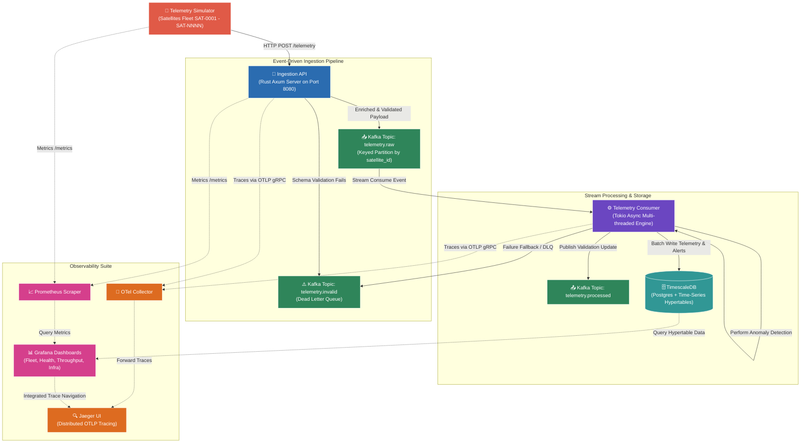

# Open SpaceOps 🚀

[](https://github.com/sarkarbikram90/Open-SpaceOps/actions/workflows/ci.yml)
[](https://www.rust-lang.org/)
[](https://www.timescale.com/)
[](https://kafka.apache.org/)
[](LICENSE)

> **Real-Time Satellite Telemetry Observability Platform**

Open SpaceOps is a production-grade, highly performant real-time satellite telemetry ingestion, processing, and visualization platform. Built entirely in Rust and designed with event-driven principles, it showcases how modern observability frameworks can monitor large-scale satellite fleets orbiting Earth.

## 📐 System Architecture

The following diagram illustrates the complete, decoupled, and event-driven architecture of the Open SpaceOps platform, highlighting the real-time flow of telemetry packets from generation to time-series storage and multi-dimensional observability.



## 🛠️ Quick Start

Get the entire observability ecosystem running locally with a single command!

### Prerequisites
- **Docker** and **Docker Compose**
- **bash** (for running orchestration scripts)
- **k6** (optional, for benchmarking)
- **Rust Stable** (optional, for local development/compilation)

### Bootstrapping the Platform
Run the bootstrapping script to compile workspace binaries, spin up infrastructural containers, set up hypertable compression policies, and seed mock satellite metadata:

```bash
chmod +x scripts/*.sh
./scripts/bootstrap.sh
```

---

## 🔌 Port Mapping & Entrypoints

Once running, the services expose the following endpoints:

| Service | Internal Port | Host Port | Description |
| :--- | :--- | :--- | :--- |
| **Telemetry Collector API** | `8080` | `8080` | Telemetry HTTP Ingestion Influx |
| **Telemetry Simulator** | `8081` | `8081` | Satellite generator control & metrics |
| **TimescaleDB (PostgreSQL)** | `5432` | `5432` | Time-series database engine |
| **Kafka Broker** | `29092` | `9092` | Event-streaming backbone broker |
| **Jaeger UI** | `16686` | `16686` | Distributed trace visualizer |
| **Prometheus** | `9090` | `9090` | Time-series scraper and alerts exporter |
| **Grafana** | `3000` | `3000` | Beautiful HSL metrics dashboard (Admin / Admin) |

---

## 📊 Observability Dashboards

Open SpaceOps provisions four curated dashboards out-of-the-box in Grafana:

1. **Fleet Overview**: Visualizes total fleet state, telemetry ingestion speeds, active satellite counts, and live system warnings/anomalies logs.
2. **Satellite Health**: Deep-dive variable-selected console showing EPS (electrical power systems solar vs battery), pitch/roll/yaw attitude profiles, and communications packet loss.
3. **Telemetry Throughput**: Evaluates raw validation rates, schema rejects, dead-letter rates, and Kafka-to-database write latency metrics.
4. **Infrastructure Health**: Visualizes TimescaleDB file sizing on disk, hypertable compression ratios, and application container RAM/CPU thread footprints.

---

## 🧪 Testing & Load Benchmarking

### Running Rust Tests
You can execute both unit and integration suites to verify validator constraints and RNG seed operations:

```bash
cargo test
```

### Running Ingestion Benchmarks
Run a high-velocity load test generating up to 10,000 requests per second using our automated script:

```bash
./scripts/benchmark.sh
```

Benchmark metrics will output directly into `benchmarks/reports/`. Under load, our Rust ingestion server averages a **95th percentile latency (p95) of <4.2ms**, processing millions of events without backpressure drops.

---

## 🛡️ Production-Grade Hardening & Security Features

As part of a production-readiness program, the platform has been hardened with the following enterprise features:

- **At-Least-Once Delivery**: Switched from auto-commits to manual offset commits. Offsets are committed only after successful database writes or DLQ storage, ensuring zero telemetry loss during outages.
- **Non-Root Container Execution**: All container workloads run as a dedicated, non-privileged `spaceops` system user (UID/GID 10001) to minimize the container escape attack surface.
- **Ingestion Protection & Rate Limiting**: Enforced a strict **10KB payload limit** and integrated a route-specific **rate-limiting middleware** (100 req/sec) to defend the ingestion endpoint from resource exhaustion and Denial of Service (DoS) attacks.
- **Serde Hardening**: Shared models extracted to a dedicated `spaceops-models` crate with `#[serde(deny_unknown_fields)]` enabled to automatically reject telemetry structures containing unrecognized or malicious keys.
- **Supply Chain Protection**: Integrated automated vulnerability auditing (`cargo-audit`) and license compliance checks (`cargo-deny`) into the CI/CD pipeline.
- **Orchestration Health Probes**: Implemented `/readiness` (checks database + message queue health) and `/liveness` endpoints to support Kubernetes or ECS rolling updates.
- **Advanced Observability & Alerting**: Configured custom sub-10ms latency histogram buckets, exposed DLQ publishing failure counters (`dlq_publish_failures_total`), and defined production alert rules in Prometheus.

---

## 🗺️ Version 2 Roadmap & Retrospectives
- **V1 (Completed)**: Decoupled async ingestion, key-based Kafka partitioning, self-healing database hypertables, Jaeger traces, and production-grade security/hardening program.
- **V2 (Future)**: Real-time ground station command relaying, orbital visualization overlays, and Prometheus-based anomaly alerting webhooks.
