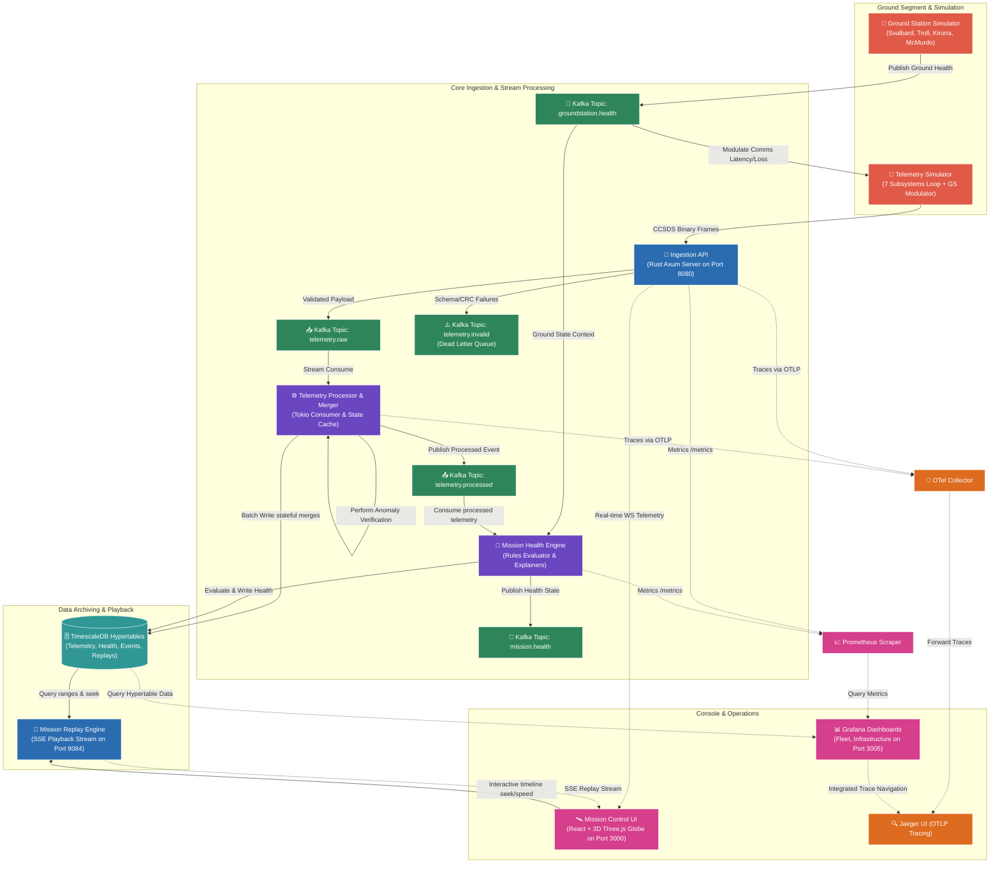

# Open SpaceOps 🚀

[](https://github.com/sarkarbikram90/Open-SpaceOps/actions/workflows/ci.yml)
[](https://www.rust-lang.org/)
[](https://www.typescriptlang.org/)
[](https://www.timescale.com/)
[](https://kafka.apache.org/)
[](LICENSE)


> **Real-Time Spacecraft Telemetry & Mission Control Observability Platform**

Open SpaceOps is a production-grade, highly performant real-time satellite telemetry ingestion, processing, replay, and visualization platform. Built entirely with Rust, React, and TypeScript, and designed with decoupled event-driven principles, it demonstrates how contemporary SRE, platform, and observability frameworks can monitor, troubleshoot, and analyze large-scale satellite fleets orbiting Earth.

---

## 🌌 Core Philosophy & Significance

Traditional satellite ground segment systems have historically relied on monolithic, closed-source, or outdated legacy monitoring software. Open SpaceOps bridges the gap between modern cloud-native software engineering and aerospace operations by applying **Site Reliability Engineering (SRE)** and **Observability Engineering** principles to space missions:

*   **Subsystem-Level Observability**: Satellites are not treated as black boxes. Telemetry is parsed, processed, and tracked at the individual spacecraft subsystem level.
*   **Time-Series Replay ("What Happened?")**: Operators can scrub back through timeline history at up to 100x speed to analyze complex failure cascades and conduct postmortems.
*   **Space-to-Ground Physics Modulations**: Communications latency, signal strength, and packet loss are dynamically simulated using real-world link budgets, weather states, and ground segment health parameters.
*   **Zero-Loss Engineering**: Built using Rust's memory safety guarantees and manual Kafka offset commits to guarantee at-least-once delivery of mission-critical state data.

---

## 🛠️ System Architecture

The decoupled, event-driven architecture of Open SpaceOps enables low-latency telemetry processing and high scalability.



---

## 🚀 Key Technical Features

### 1. Onboard Spacecraft Subsystems Modeling
*   Emits independent telemetry streams from **7 core subsystems**:
    1.  **Power (EPS)**: Battery voltage, currents, and solar array output metrics.
    2.  **Thermal Control (TCS)**: Onboard core CPU temperatures.
    3.  **Communications (TTC)**: Signal strength (RSSI), packet loss, and transmission latency.
    4.  **Propulsion (PROP)**: Fuel capacity, altitude, and current velocity.
    5.  **ADCS (Attitude Determination & Control)**: Orientation pitch, roll, and yaw angles.
    6.  **Payload**: Instrument activity state and power draw levels.
    7.  **Flight Computer (OBC)**: CPU load and memory usage metrics.
*   Physical side-effects are dynamically propagated across subsystems (e.g., thermal spikes trigger CPU throttling, causing ADCS control degradation; battery depletion causes payload safety shutdowns).

### 2. Ground Station Link Modulator
*   Simulates four main ground stations: **Svalbard (GS-0001)**, **Troll (GS-0002)**, **Kiruna (GS-0003)**, and **McMurdo (GS-0004)**.
*   Injects real-time orbital pass factors including signal degradation, antenna mechanical faults, backhaul network congestion, and atmospheric weather states (storms, heavy snow).

### 3. CCSDS-Inspired Binary Telemetry Layer
*   Uses [crates/spaceops-packets](crates/spaceops-packets) to enforce structured binary serialization (`application/octet-stream`).
*   Implements a custom **CRC-16-CCITT checksum validation** to reject corrupt packets during ground segment uplink, maintaining a JSON fallback endpoint for open integrations.

### 4. Mission Replay & Playback Controller
*   Supports historical telemetry range queries through [apps/mission-replay-engine](apps/mission-replay-engine).
*   Streams events using Server-Sent Events (SSE) at **1x, 5x, 10x, 50x, or 100x speed**.
*   Supports pause, resume, and instant timeline scrubbing (seeking).

### 5. 3D Mission Control Console
*   A premium React/TypeScript client console ([apps/mission-control-ui](apps/mission-control-ui)) built with Vanilla CSS (HSL dark system themes).
*   **3D Earth & Orbit Tracking**: Uses Three.js to render a sleek, cybernetic wireframe globe with live satellite positions, orbital inclinations, and active color-coded communication beams showing ground station connections.
*   **Subsystem Diagnostic Panels**: Real-time diagnostic cards for all 7 subsystems, ground network load monitors, and a structured events log filterable by severity level (INFO, WARNING, CRITICAL).

---

## 🔌 Port Mapping & Ecosystem Endpoints

Once fully initialized, the platform exposes the following developer interfaces:

| Interface / Service | Host Port | Protocol | Description |
| :--- | :--- | :--- | :--- |
| **Mission Control Console** | `3000` | HTTP | Live Operations & 3D Orbit tracking console |
| **Telemetry Collector API** | `8080` | HTTP/WS | Telemetry binary/JSON ingestion & WS streaming |
| **Telemetry Simulator** | `8081` | HTTP | Simulator telemetry generator metrics |
| **Mission Health Engine** | `8082` | HTTP | Health score rules metrics exporter |
| **Ground Station Simulator** | `8083` | HTTP | Link budget metrics exporter |
| **Mission Replay Engine** | `8084` | HTTP/SSE | Replay controls and Server-Sent Events stream |
| **Grafana** | `3005` | HTTP | Operational metrics dashboards (`admin` / `admin`) |
| **Prometheus** | `9090` | HTTP | Ingestion metrics database & scrapers |
| **TimescaleDB (Postgres)** | `5432` | TCP | Time-series database containing telemetry & alerts |
| **Jaeger UI** | `16686` | HTTP | Distributed tracing dashboard |

---

## 🛠️ Quick Start

### Prerequisites
*   **Docker** & **Docker Compose**
*   **Node.js (v20+)** (for local UI development)
*   **Rust (v1.82+)** (for local backend compilation)

### Initial Launch & Bootstrap
Configure directories, build local images, run migrations, and seed default tables using the integrated script:

```bash
# Set script permissions
chmod +x scripts/*.sh

# Run the bootstrap sequence
./scripts/bootstrap.sh
```

This launches all components in the background. Open [http://localhost:3000](http://localhost:3000) to view the Mission Control UI.

---

## 🧪 Testing & Validation

Verify system-wide health and constraints by running the integrated Rust test suite:

```bash
# Run unit and integration tests across all workspace crates
cargo test
```

For frontend client verification:

```bash
cd apps/mission-control-ui
npm run build
```

---

## 🛡️ Production Hardening (SRE Profile)

Open SpaceOps has been engineered to comply with enterprise-grade reliability and security audits:

*   **Non-Root Execution**: Every service container runs under a dedicated system user `spaceops` with UID/GID `10001` (complying with standard Kubernetes security policies).
*   **At-Least-Once Database Guarantee**: The processor commits Kafka offsets manually only after successful batch insertion into TimescaleDB or writing to the Dead Letter Queue (DLQ).
*   **Ingestion Defense**: Axis endpoints reject payloads exceeding **10KB** and apply a strict token-bucket rate limiter to protect resources from Denial of Service (DoS) attempts.
*   **Serde Deny**: Shared models enforce `#[serde(deny_unknown_fields)]` to prevent injection of unmapped attributes.

---

## 🗺️ Project Roadmap

- [x] **Phase 1**: Spacecraft Subsystem Models & sparse streams.
- [x] **Phase 2**: Mission Health Engine & Fleet score evaluator.
- [x] **Phase 3**: Ground Station Simulator & space-to-ground link modulations.
- [x] **Phase 4**: CCSDS-inspired binary telemetry format & CRC-16 layers.
- [x] **Phase 5**: Mission Replay playback engine with SSE streams.
- [x] **Phase 6**: React/TypeScript Mission Control console.
- [x] **Phase 7**: Three.js 3D earth track and communication beams visualization.
- [ ] **Phase 8**: AI Incident Commander (automated incident summaries, root cause timelines, and recovery runbooks via LLMs).
