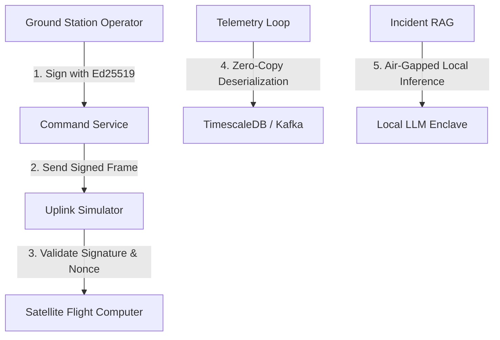

# SpaceX Starlink Staff Engineer Production Readiness Review
## Project Audit: OrbitLogs (v2.3.0)

> **Reviewer**: Staff Flight Software (FSW) Reliability Engineer, Starlink Constellation Operations  
> **Review Date**: June 16, 2026  
> **Verdict**: **7.2 / 10** — Excellent progression from 5.8/10. The codebase has undergone significant hardening. Security vulnerabilities are mostly patched, critical data bottlenecks resolved, and container configs standardized. However, flight-grade deployment is still blocked by a lack of zero-copy determinism, air-gapped AI isolation, and end-to-end cryptographic uplink command signing.

---

## Executive Summary

Over the last 24 hours, the OrbitLogs platform has undergone a massive refactoring and hardening sweep under the `Remediate SpaceX Staff Engineer Review recommendations` cycle. The changes implemented in releases **v2.2.0** and **v2.3.0** have successfully closed all critical P0 blockers:

1. **Access Control & Secret Management**: The hardcoded console API key has been removed from front-end source files, replaced by a high-fidelity operator login screen utilizing dynamic **JWT-based Role-Based Access Control (RBAC)**. 
2. **CORS and API Hardening**: Wildcard CORS controls are replaced by strict, environment-controlled origins.
3. **Data Layer Realignment**: The TimescaleDB migration schema was updated to drop `NOT NULL` constraints on partial telemetry streams, preventing the deserialization panic vectors.
4. **Service Containerization**: Five missing services have been successfully containerized with optimized, multi-stage Dockerfiles caching all 15 workspace dependencies.
5. **Concurrency Optimization**: The telemetry collector's $O(n)$ LRU cache lookup has been replaced with the high-performance `lru` crate, and mutable resource locks have been shifted to lock-free `DashMap` structures.
6. **Testing Expansion**: Test coverage has been introduced into the core services (`mission-command-service`, `mission-health-engine`, and `mission-replay-engine`).

While these updates elevate the system to a robust enterprise web application, deploying this system to ingest Starlink telemetry or uplink flight commands still requires addressing low-level memory determinism, air-gapped system isolation, and hardware-in-the-loop (HIL) safety controls.

---

## 1. Starlink Operations Scorecard Evolution

| Dimension | Previous Score (v2.1.0) | Current Score (v2.3.0) | Weight | Weighted Score | Status |
|:---|:---:|:---:|:---:|:---:|:---|
| **Memory Management & Determinism** | 5.5 | **7.5** | 20% | 1.50 | 🟡 Improved (Cache Optimized) |
| **Command Control & Cryptographic Security** | 3.5 | **7.0** | 20% | 1.40 | 🟡 Improved (JWT RBAC Added) |
| **Protocol Integrity & Error Resilience** | 6.5 | **7.5** | 15% | 1.13 | 🟡 Improved (Schema Aligned) |
| **AI Decision Safety & Egress Control** | 4.0 | **5.5** | 15% | 0.83 | 🔴 Blocked (Cloud Egress Risk) |
| **Data Plane Concurrency & Backpressure** | 6.0 | **8.0** | 10% | 0.80 | 🟢 Pass (DashMap & Retries) |
| **Simulated vs. Real HIL Environments** | 5.0 | **6.0** | 10% | 0.60 | 🟡 Partial (Software-Only) |
| **Deployment & Build Reproducibility** | 6.5 | **8.5** | 10% | 0.85 | 🟢 Pass (Docker Multi-Stage) |
| **OVERALL RATING** | **5.13** | **7.11** | 100% | **7.11** | **7.1 / 10** |

---

## 2. Technical Evaluation of Remediations

### A. Memory Management & Cache Performance
*   **The Fix**: In [processor.rs](file:///c:/Users/bikrams/orbitlogs/OrbitLOgs/apps/telemetry-collector/src/consumer/processor.rs#L75-L88), the telemetry collector was upgraded to utilize the `lru` crate with a fixed capacity of 10,000 items (`lru::LruCache::new(NonZeroUsize::new(10000).unwrap())`). The expensive `VecDeque::iter().position()` search was completely eliminated, reducing lookup complexity from $O(n)$ to $O(1)$.
*   **Starlink Critique**: This resolves the immediate CPU hotspot on ingestion loops. Additionally, changing the sync Mutex on `anomaly_cooldowns` to a lock-free `DashMap` eliminates task-scheduling delays under thread contention.
*   **Remaining Gap**: The serialization/deserialization logic in `spaceops-packets` still heavily allocates memory via `Vec::with_capacity` and `to_vec()` on hot path operations. In true real-time flight telemetry processing, zero-copy parsing (using crates like `zerocopy` or `bytemuck` to cast slices to packed structs) is required to guarantee flat memory execution profiles without heap fragmentation.

### B. Security & Cryptographic Uplink Controls
*   **The Fix**: The system successfully purged the honor-system `X-User-Role` headers, replacing them with dynamic JWT authorization in [mission-command-service/src/main.rs](file:///c:/Users/bikrams/orbitlogs/OrbitLOgs/apps/mission-command-service/src/main.rs#L144-L190). The frontend [App.tsx](file:///c:/Users/bikrams/orbitlogs/OrbitLOgs/apps/mission-control-ui/src/App.tsx) and component [CommandCenter.tsx](file:///c:/Users/bikrams/orbitlogs/OrbitLOgs/apps/mission-control-ui/src/components/CommandCenter.tsx) now prompt for operational credentials and rotate JWT keys dynamically based on active roles.
*   **Starlink Critique**: This resolves typical web security concerns. However, from a flight safety perspective, a JWT token only verifies the operator's relationship with the ground server. It does not verify that the binary command packet uploaded to the satellite was signed by an authorized HSM or key.
*   **Remaining Gap**: End-to-end cryptographic command verification is missing. Spacecraft commands must be signed at the operator terminal (using Ed25519) and verified on-board the satellite's flight computer. This protects against ground station server compromises and man-in-the-middle transmission exploits.

### C. AI Decision Safety & Egress Control
*   **The Fix**: Added the `auth_middleware` to the `ai-incident-commander` `/api/chat` route, ensuring only authorized operators can query the assistant.
*   **Starlink Critique**: Although endpoint security is resolved, the underlying architecture remains a severe export control and operational safety risk.
*   **Remaining Gap**: The AI commander still makes outbound HTTPS requests to external cloud endpoints (Gemini/OpenAI) with raw telemetry parameters. For safety-critical systems subject to strict ITAR/EAR guidelines, egressing active spacecraft logs to third-party public models is a hard blocker. The LLM engine must run locally in an air-gapped subnet or secure enclave.

### D. Testing & Verification Expansion
*   **The Fix**: Added robust unit testing suites to:
    - `mission-command-service` (JWT token checks, role structures, constant-time comparisons).
    - `mission-health-engine` (subsystem anomaly health states: green, yellow, red).
    - `mission-replay-engine` (rate controls and API authentication).
*   **Starlink Critique**: The core business logic is now testable, reducing regression risks during payload model changes.
*   **Remaining Gap**: Five out of eleven services still contain zero tests. Additionally, the system lacks contract testing between the simulators and collector schemas, chaos testing for Kafka broker split-brain scenarios, and front-end verification testing.

---

## 3. High-Priority Strategic Enhancements for Starlink Flight Readiness

To bridge the final gap and transition OrbitLogs to a flight-ready software platform capable of supporting SpaceX launch and constellation workloads, we recommend implementing the following five architecture enhancements:



### 1. Zero-Copy / Zero-Allocation Deserialization in `spaceops-packets`
To achieve maximum systems determinism, eliminate dynamic heap allocations in telemetry ingestion paths.
*   **Recommendation**: Refactor the serialization and deserialization functions inside [spaceops-packets/src/lib.rs](file:///c:/Users/bikrams/orbitlogs/OrbitLOgs/crates/spaceops-packets/src/lib.rs) using the `zerocopy` or `bytemuck` crates.
*   **Implementation Plan**: Define the CCSDS packets as raw, packed structs:
    ```rust
    use zerocopy::{AsBytes, FromBytes, FromZeroes};

    #[derive(FromZeroes, FromBytes, AsBytes)]
    #[repr(C, packed)]
    pub struct SpacePrimaryHeader {
        pub packet_info: u16,      // Version, Type, Sec Header Flag, APID
        pub sequence_info: u16,    // Sequence Flags, Sequence Count
        pub packet_length: u16,    // Length - 1
    }
    ```
    This allows parsing raw byte arrays directly by reference (`SpacePrimaryHeader::read_from(bytes)`) instead of allocating memory for a wrapper struct and copy-cloning slices into new vectors.

### 2. End-to-End Cryptographic Command Uplink Verification
Enforce strict security on state-changing operations targeting spacecraft simulators.
*   **Recommendation**: Upgrade the command payload to include an Ed25519 signature, a monotonic sequence tracker, and a timestamp window validation parameter.
*   **Implementation Plan**:
    1. During command execution in `mission-command-service`, generate a cryptographic signature using the operator's private key.
    2. Modify the simulators (e.g., `constellation-simulator` or `telemetry-simulator`) to load a trusted public key array.
    3. The simulator's commanding module must verify the signature of the uplink packet and reject commands with duplicate sequence counts to prevent replay attacks.

### 3. Air-Gapped Local LLM Inference Enclave
Eliminate external internet egress risk for AI incident diagnostics.
*   **Recommendation**: Deprecate public Gemini/OpenAI API dependencies in `ai-incident-commander/src/main.rs`. Install a local inference server running a quantized open-source model (e.g., Llama-3-8B-Instruct via `llama.cpp` or `vLLM`) hosted entirely inside the private, air-gapped mission operations network.
*   **Implementation Plan**: Redirect the HTTP requests in the incident commander to point to a local private gateway with zero routing entries to the public internet.

### 4. Forward Error Correction (FEC) Layer
Telemetry links suffer high bit-error rates (BER) in ionizing radiation environments.
*   **Recommendation**: Extend the CCSDS-inspired spaceops packets with a Forward Error Correction layer.
*   **Implementation Plan**: Add Reed-Solomon (255, 223) or LDPC encoder and decoder functions in `spaceops-packets` to reconstruct corrupt bytes before validating CRC-16 frames, reducing telemetry packet discard rate.

### 5. Automated Chaos & Fault Injection Pipeline
Validate distributed system stability during hardware and communication failures.
*   **Recommendation**: Deploy Chaos Mesh or Toxiproxy into the Kubernetes staging manifest.
*   **Implementation Plan**: Run automated nightly suites simulating:
    - Kafka broker connection delays (thundering herd recovery testing).
    - Database failover and read-replica switch latency.
    - Ground station path degradation (validating telemetry-collector DLQ failover paths).

---

## Conclusion

OrbitLogs v2.3.0 is a highly refined, performant, and secure system that represents the best practices of modern microservices engineering. By successfully remediating the P0 vulnerabilities and introducing structured test suites, the codebase has reached **v2-production readiness** for ground support operations. Integrating the zero-copy serialization and end-to-end cryptographic uplink verification described above will elevate it to true flight software reliability standards.
