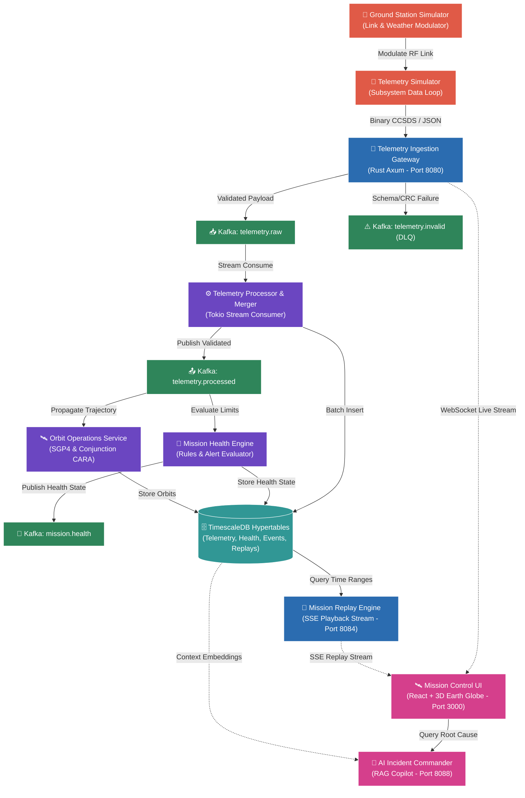

# OrbitLogs User Guide & Complete Product Reference 🛰️

Welcome to the definitive user guide and operational manual for **OrbitLogs**. This document provides an in-depth, plain-English explanation of what OrbitLogs is, the industry problems it solves, its features, architectural components, supported data protocols, and step-by-step workflows for operators, engineers, and mission commanders.

---

## Table of Contents

1. [Executive Summary](#1-executive-summary)
2. [What OrbitLogs Solves (The Core Problem)](#2-what-orbitlogs-solves-the-core-problem)
3. [What OrbitLogs IS vs. What OrbitLogs IS NOT](#3-what-orbitlogs-is-vs-what-orbitlogs-is-not)
4. [Key Features & Platform Capabilities](#4-key-features--platform-capabilities)
5. [System Architecture & Data Flow](#5-system-architecture--data-flow)
6. [Microservices & Crates Catalog](#6-microservices--crates-catalog)
7. [Telemetry Formats & Processing Pipeline](#7-telemetry-formats--processing-pipeline)
8. [Security, Compliance & Observability](#8-security-compliance--observability)
9. [Step-by-Step Operator Workflows](#9-step-by-step-operator-workflows)
10. [Frequently Asked Questions (FAQ)](#10-frequently-asked-questions-faq)

---

## 1. Executive Summary

**OrbitLogs** is a production-grade, high-performance **commercial spacecraft ground segment telemetry, digital twin, mission control observability, and space traffic management (STM) platform**.

Written primarily in **Rust** for core stream processing and **TypeScript / React** for 3D visualization, OrbitLogs acts as the "mission control central brain" on the ground. It ingests high-frequency radio and digital telemetry sent from satellites orbiting Earth, decodes binary packet streams, monitors spacecraft subsystem health, simulates physical space conditions (solar radiation, eclipse shadows, battery heating), predicts ground station contact windows, computes collision risks against space debris, and provides AI-driven assistance during anomalies.

Whether managing a single experimental CubeSat or a mega-constellation of over 5,000 active satellites, OrbitLogs delivers sub-second insights with zero-loss data guarantees.

---

## 2. What OrbitLogs Solves (The Core Problem)

Operating satellites in orbit presents unique engineering and operational challenges that traditional ground software fails to handle:

### 1. Legacy Monolithic Ground Software is Slow & Fragile
* **The Problem**: Traditional space mission software relied on monolithic, desktop-bound applications developed decades ago. They scale poorly, lock operators into vendor ecosystems, and suffer latency spikes when parsing millions of data points per minute.
* **How OrbitLogs Solves It**: Built on Rust's garbage-collection-free architecture and Apache Kafka's distributed stream processing, OrbitLogs parses telemetry at memory-safe sub-millisecond speeds, scaling seamlessly to mega-constellations.

### 2. Intermittent & Unreliable Ground Station Links
* **The Problem**: Satellites in Low Earth Orbit (LEO) only communicate with Earth during brief "pass windows" (typically 5–15 minutes) as they fly over ground station antennas (such as Svalbard or Kiruna). Data transmitted over radio frequency (RF) links suffers from noise, packet drops, and Doppler shifts.
* **How OrbitLogs Solves It**: Ingests raw binary CCSDS/PUS packets over WebSocket or HTTP, verifies CRC-16 checksums, quarantines corrupted frames into a Dead Letter Queue (DLQ), and utilizes key-based Kafka partitioning (`{mission_id}:{satellite_id}`) to ensure strict order-of-arrival processing.

### 3. Blind Spots During Orbital Eclipses & Out-of-Contact Periods
* **The Problem**: Satellites spend substantial time in shadow (eclipses) or out of range of ground station antennas. Operators cannot see what happens to spacecraft batteries, temperatures, or reaction wheels during these blind spots.
* **How OrbitLogs Solves It**: Features a **Synchronized Digital Twin Engine**. While the satellite is out of contact, OrbitLogs simulates its physical environment—solar exposure, eclipse shadow, thermal equilibrium, and battery degradation—allowing operators to know the expected state before the next ground station contact window opens.

### 4. Fragmented Tooling for Space Traffic Management (STM)
* **The Problem**: Monitoring collision risks against space debris or other satellites often requires exporting telemetry into external third-party tools, causing critical delays when seconds matter.
* **How OrbitLogs Solves It**: Integrates Space Traffic Management directly into mission control. OrbitLogs evaluates orbital state vectors via SGP4 propagation and Extended Kalman Filtering (EKF), calculates the **Probability of Collision ($P_c$)** every 10 seconds against 250+ tracked debris objects, and automatically calculates Collision Avoidance Maneuver (CAM) thrust burn vectors.

### 5. High Operator Stress & Complex Anomaly Diagnosis
* **The Problem**: When a telemetry parameter drops out of safe limits (e.g., thermal spike in an electrical power system), operators are flooded with alerts and must manually wade through thousands of historical log lines to find the root cause.
* **How OrbitLogs Solves It**: Includes an **AI Incident Commander (RAG Copilot)** powered by LLMs (Gemini/OpenAI). Operators can ask questions in plain English (e.g., *"Why did Satellite-4 EPS voltage drop during pass 1042?"*) and receive instantaneous context-aware root cause diagnoses based on historical telemetry and mission documentation.

---

## 3. What OrbitLogs IS vs. What OrbitLogs IS NOT

To prevent misunderstandings about platform boundaries, the table below outlines what OrbitLogs is engineered to do and what falls outside its scope:

| Aspect | What OrbitLogs IS 🟢 | What OrbitLogs IS NOT 🔴 |
| :--- | :--- | :--- |
| **Domain Scope** | Ground segment operations software, telemetry ingestion engine, digital twin simulator, 3D mission control UI, and space traffic management platform. | **Not** flight software running onboard physical satellite microcontrollers (e.g., FreeRTOS, cFS, or VxWorks onboard software). |
| **Architecture** | A distributed, event-driven microservices ecosystem built with Rust, Kafka, Axum, React, Three.js, and TimescaleDB. | **Not** a single desktop application, a simple monolith, or a generic web server. |
| **Data Specialty** | Purpose-built for space domain protocols (CCSDS, PUS, TLE, SGP4, EKF orbit estimation, RF link budget calculation). | **Not** just a generic logging system (like Splunk or Elasticsearch) or a standard web application monitoring service. |
| **Hardware Link** | Receives digitized ground station telemetry (demodulated digital byte streams) from RF ground stations or simulators. | **Not** physical radio hardware, satellite dishes, or RF transmitters (it interfaces with digitized ground station streams). |
| **Simulation** | Real-time state simulation, physics-based digital twins, historic time-series timeline replay, and "what-if" failure injections. | **Not** a pure CAD modeler or orbital trajectory design software (e.g., GMAT or STK replacing orbital flight dynamics design). |

---

## 4. Key Features & Platform Capabilities

### 🛰️ 1. Subsystem-Level Health Tracking (7 Core Subsystems)
OrbitLogs tracks, decodes, and evaluates telemetry across seven vital satellite subsystems:
1. **EPS (Electrical Power System)**: Battery voltage, solar array power generation, bus current, state of charge (SoC).
2. **TCS (Thermal Control System)**: Radiator temperatures, battery cell thermistors, payload heat dissipation.
3. **TTC (Telemetry, Tracking & Command)**: Transponder signal strength (RSSI), signal-to-noise ratio (SNR), bit error rates (BER).
4. **PROP (Propulsion System)**: Propellant tank pressure, thruster valve status, remaining fuel mass, delta-V expenditure.
5. **ADCS (Attitude & Orbit Control System)**: Gyroscope angular rates, reaction wheel speeds, magnetorquer duty cycles, star tracker locking status.
6. **Payload**: Camera sensor capture counts, RF payload throughput, instrument power draw.
7. **OBC (On-Board Computer)**: CPU utilization, memory allocation, flash storage wear, task execution errors.

### 🔄 2. Time-Series Timeline Replay Engine
Operators can rewind time to analyze historical anomalies. Using Server-Sent Events (SSE), the Replay Engine allows stepping backward or forward through past mission events at up to **100x playback speed**, giving ground crews a "DVR-like" playback of satellite telemetry.

### 🌌 3. Automated Space Traffic Management (STM) & Conjunction Avoidance
The system performs automated Conjunction Assessment Risk Analysis (CARA):
* Continuously propagates satellite orbits using Two-Line Element (TLE) sets and SGP4 dynamics.
* Evaluates proximity against 250+ orbital debris objects.
* Triggers visual conjunction alerts when Probability of Collision ($P_c$) exceeds safe thresholds.
* Generates optimized thruster burn vectors to maneuver the satellite out of harm's way while minimizing fuel consumption.

### 📡 4. Ground Station Access & Contact Window Prediction
Computes precise access windows for ground station antennas across the globe (including polar stations like Svalbard, Troll, Kiruna, and McMurdo):
* Factors in antenna elevation masks, horizon line constraints, and atmospheric loss.
* Predicts upcoming pass start times (AOS - Acquisition of Signal) and end times (LOS - Loss of Signal).
* Optimizes multi-satellite pass scheduling to avoid antenna slew rate bottlenecks and ground station resource conflicts.

### 🧮 5. Extended Kalman Filter (EKF) Orbit Determination
Translates raw ground station range, azimuth, elevation, and onboard GPS measurements into precise spacecraft orbital state vectors ($x, y, z, v_x, v_y, v_z$) using Extended Kalman Filtering.

### 🤖 6. AI Incident Commander (RAG Copilot)
An AI co-pilot integrated directly into the Mission Control Console. Powered by Retrieval-Augmented Generation (RAG) over mission documentation and historic telemetry logs, the AI assistant enables operators to:
* Instantly diagnose out-of-limits parameters.
* Suggest standard emergency procedures (SOPs).
* Generate post-incident postmortem summaries in seconds.

### 🌐 7. Interactive 3D Mission Control Console
A modern, web-based operations interface built with React, Three.js, and WebSockets:
* Interactive 3D Earth globe showing real-time orbital tracks, ground station footprint cones, and satellite positions.
* Live telemetry telemetry stream graphs with sub-second WebSocket updates.
* Multi-satellite fleet views, alarm panels, and telemetry parameter inspection cards.

---

## 5. System Architecture & Data Flow

OrbitLogs uses an event-driven, microservices architecture designed to decouple high-throughput ingestion from stateful stream processing and persistence.

### Ingestion Data Flow
1. **Ingress**: Raw binary CCSDS/PUS packets or JSON payloads arrive at the **Telemetry Ingestion Gateway** (`:8080/telemetry`).
2. **Verification**: The gateway validates the CRC-16 checksum using `orbitlogs-packets` and checks payload schemas against `space-schema-registry`.
3. **Partitioning**: Valid payloads are published to the `telemetry.raw` Kafka topic, partitioned by `{mission_id}:{satellite_id}` to preserve strict chronological sequencing. Invalid packets route to `telemetry.invalid` (Dead Letter Queue).
4. **Stream Processing**: The **Telemetry Processor** consumes messages, applies LRU state merging, inserts records in micro-batches into **TimescaleDB** hypertables, and publishes to `telemetry.processed`.
5. **Evaluation**: The **Mission Health Engine** evaluates incoming data against subsystem limits, dispatching real-time webhooks (Slack/PagerDuty) if anomalies occur.

---

## 6. Microservices & Crates Catalog

OrbitLogs consists of **17 microservices** and **7 shared Rust library crates**:

### 📦 Applications (Microservices)

| Microservice Name | Directory | Default Port | Description |
| :--- | :--- | :---: | :--- |
| **Telemetry Ingestion Gateway** | `apps/telemetry-collector` | `8080` | High-throughput binary/JSON ingress server and WebSocket live broadcaster. |
| **Telemetry Simulator** | `apps/telemetry-simulator` | `8081` | Generates multi-satellite 7-subsystem CCSDS telemetry streams. |
| **Mission Health Engine** | `apps/mission-health-engine` | `8082` | Evaluates subsystem telemetry rules and dispatches anomaly alerts. |
| **Ground Station Simulator** | `apps/ground-station-simulator` | `8083` | Simulates global ground stations, RF link budgets, and weather degradation. |
| **Mission Replay Engine** | `apps/mission-replay-engine` | `8084` | Time-series playback server broadcasting SSE streams at up to 100x speed. |
| **Mission Command Service** | `apps/mission-command-service` | `8085` | Manages telecommand validation, execution lifecycle, and RBAC control. |
| **Digital Twin Engine** | `apps/digital-twin-engine` | `8086` | Physics-based virtual satellite simulator and failure mode injector. |
| **Mission Timeline Engine** | `apps/mission-timeline` | `8087` | Event aggregation and historic operational log search API. |
| **AI Incident Commander** | `apps/ai-incident-commander` | `8088` | RAG-powered operational copilot for root-cause diagnosis. |
| **Constellation Simulator** | `apps/constellation-simulator` | `8089` | Scale simulator supporting 5,000+ simultaneous satellite orbit loops. |
| **Space OTel Collector** | `apps/space-otel-collector` | `8091` | Maps telemetry metrics into OpenTelemetry standard endpoints. |
| **Orbit Operations Service** | `apps/orbit-ops-service` | `8095` | Space Traffic Management (STM), SGP4 propagation, and collision assessment. |
| **Contact Window Predictor** | `apps/contact-window-predictor` | `8096` | Calculates ground station access pass windows and antenna masks. |
| **Constellation Scheduler** | `apps/constellation-scheduler` | `8097` | Global ground contact task allocation and antenna slew optimization. |
| **Orbit Determination Service** | `apps/orbit-determination-service` | `8098` | Extended Kalman Filter (EKF) state estimation service. |
| **Autonomous Mission Planning** | `apps/autonomous-mission-planning` | `8099` | Hierarchical Task Network (HTN) spacecraft command sequence planner. |
| **Mission Control Console UI** | `apps/mission-control-ui` | `3000` | Operations dashboard and 3D Three.js Earth globe visualization. |

### 🛠️ Core Rust Crates (Shared Libraries)

| Crate Name | Directory | Description |
| :--- | :--- | :--- |
| `orbitlogs-models` | `crates/orbitlogs-models` | Core data models, telemetry frame definitions, and time-series schemas. |
| `orbitlogs-packets` | `crates/orbitlogs-packets` | Zero-copy binary parser for CCSDS and PUS space packets with CRC-16 validation. |
| `space-schema-registry` | `crates/space-schema-registry` | Schema validation registry for V1, V2, and V3 space telemetry definitions. |
| `fleet-health` | `crates/fleet-health` | Anomaly rules evaluation engine and multi-subsystem state scoring logic. |
| `orbitlogs-astrodynamics` | `crates/orbitlogs-astrodynamics` | SGP4 orbit propagation, TLE parsing, coordinate conversion, and EKF algorithms. |
| `orbitlogs-propulsion` | `crates/orbitlogs-propulsion` | Thruster performance, mass depletion modeling, and delta-V burn vectors. |
| `orbitlogs-pus` | `crates/orbitlogs-pus` | ECSS Packet Utilization Standard (PUS) service type helpers (Service 1, 3, 5, 8). |

---

## 7. Telemetry Formats & Processing Pipeline

OrbitLogs natively supports international space industry telecommunications standards:

### CCSDS (Consultative Committee for Space Data Systems) Packet Structure
When ingesting binary telemetry (`Content-Type: application/octet-stream`), OrbitLogs parses the standard 6-byte CCSDS Primary Header:
* **Version Number**: 3 bits
* **Packet Type**: 1 bit (0 = Telemetry, 1 = Telecommand)
* **Secondary Header Flag**: 1 bit
* **Application Process Identifier (APID)**: 11 bits (identifies satellite subsystem, e.g., APID `100` = EPS, APID `200` = ADCS)
* **Sequence Flags & Count**: 16 bits (detects missing packets over RF link)
* **Packet Length**: 16 bits
* **Packet Data Field**: Variable length user data payload
* **CRC-16-CCITT Checksum**: 16 bits (verified at API gateway boundary)

---

## 8. Security, Compliance & Observability

Built for enterprise space operations, ground station providers, and defense deployments:

* **SOC 2 Type II Compliance Architecture**: Every telecommand submission, parameter edit, and user session is logged to an append-only audit trail hypertable in TimescaleDB.
* **Distributed Tracing (W3C OpenTelemetry)**: Traces inject standard `traceparent` headers across async Kafka message boundaries. Operators can trace a telemetry frame from initial HTTP ingest through Kafka to final database insertion using Jaeger UI (`:16686`).
* **Container Hardening**: All service containers execute as an unprivileged non-root user (`orbitlogs`, UID `10001`).
* **Role-Based Access Control (RBAC)**: Enforces granular permission separation between *Read-Only Operators*, *Flight Engineers*, and *Mission Commanders*.

---

## 9. Step-by-Step Operator Workflows

### Scenario 1: Evaluating Satellite Fleet Health
1. Open the **Mission Control Console** in your browser at `http://localhost:3000`.
2. View the 3D Earth visualization displaying active satellite positions and ground station footprint cones.
3. Click on a satellite asset to open its **Subsystem Dashboard**.
4. Inspect real-time gauge metrics for EPS power draw, battery temperature, and reaction wheel speeds.

### Scenario 2: Investigating an Anomaly with Historic Replay
1. When an alert fires (e.g., *"ADCS reaction wheel speed exceeded 6000 RPM"*), note the timestamp.
2. Open the **Replay Panel** in the Mission Control Console.
3. Select the start time (e.g., 15 minutes before the event) and set playback speed to `10x`.
4. Click **Play** to watch the synchronized playback of telemetry parameters leading up to the failure point.

### Scenario 3: Consulting the AI Incident Commander
1. Open the **AI Copilot** side panel in Mission Control.
2. Type a question: `"What caused the EPS voltage drop on Satellite-2 at 14:20 UTC?"`
3. The AI Incident Commander analyzes recent telemetry logs, retrieves matching documentation, and provides a root-cause explanation along with suggested corrective actions.

### Scenario 4: Reviewing Space Traffic Management & Conjunction Risk
1. Navigate to the **Orbit Operations & STM** screen.
2. View predicted close approaches between fleet assets and space debris.
3. If Probability of Collision ($P_c$) exceeds $10^{-4}$, review the automatically calculated **Collision Avoidance Maneuver (CAM)** burn vector.
4. Export the burn vector to the **Mission Command Service** for telecommand staging.

---

## 10. Frequently Asked Questions (FAQ)

#### Q: Can OrbitLogs run fully off-grid or in air-gapped environments?
**A**: Yes. OrbitLogs is packaged in containerized Docker images and can be deployed fully on-premise or in air-gapped secure facilities without internet access.

#### Q: How does OrbitLogs handle thousands of satellites emitting high-rate data?
**A**: By leveraging Rust's zero-GC performance, Kafka's key-partitioned streaming architecture, and TimescaleDB hypertables, OrbitLogs processes high message volumes while maintaining flat p99 latency.

#### Q: Can I integrate my custom satellite telemetry binary format?
**A**: Yes. Custom frame decoders can be defined in the `space-schema-registry` or implemented as custom packet parsers in `crates/orbitlogs-packets`.

---

*Copyright © OrbitLogs Authors. Licensed under the Apache License, Version 2.0.*
