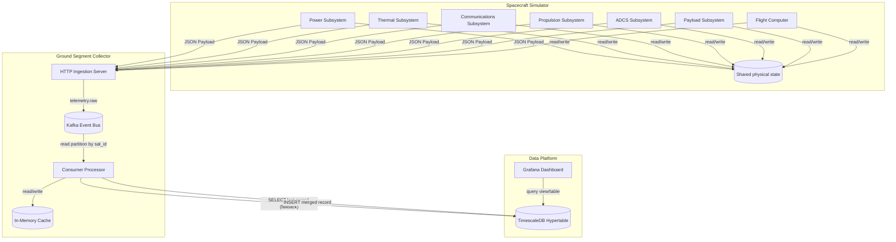
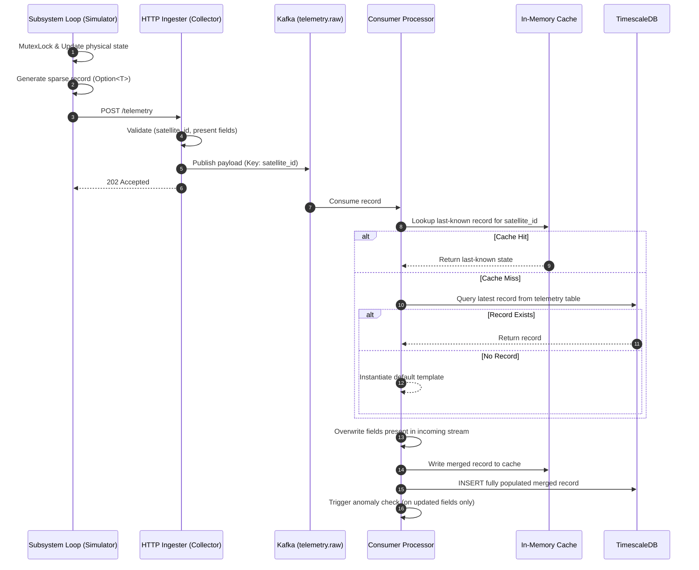
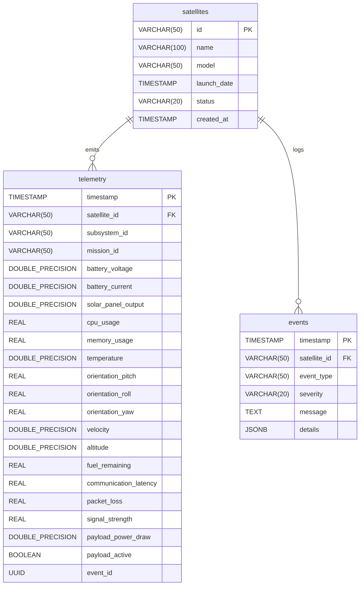
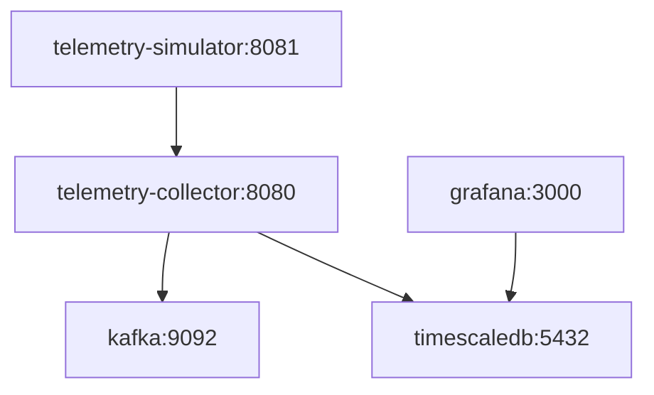

# Phase 1: Spacecraft Subsystem Telemetry Architecture & Design

This document details the architecture, design, failure modes, operational runbooks, and troubleshooting guides for the spacecraft subsystem telemetry system implemented in Phase 1.

---

## 1. System Architecture

The Open SpaceOps system has been refactored to support concurrent, independent telemetry streams from seven spacecraft subsystems per satellite: Power, Thermal, Communications, Propulsion, ADCS, Payload, and Flight Computer. 

### Component Diagram



---

## 2. Telemetry Flow & Merging Logic

To support backward compatibility with existing dashboards that query a single flat table (`telemetry`), the collector's consumer runs a stateful merge logic. Since Kafka partitioning guarantees that all events for a specific `satellite_id` are processed sequentially by the same consumer instance, the consumer uses a fast in-memory cache of the latest satellite state, falling back to a database lookup on a cache miss.

### Sequence Diagram



---

## 3. Database Schema Design (ER Diagram)

The database schema is updated to add correlation keys (`subsystem_id`, `mission_id`), introduce Payload subsystem metrics, and drop `NOT NULL` constraints on metrics columns to support both unified and sparse telemetry.



---

## 4. Failure Modes & Side-Effect Propagation

Real spacecraft subsystems are physically coupled. The simulator models these dependencies dynamically:

| Trigger Scenario | Cause (Subsystem) | Immediate Metric Shift | Propagated Side Effect |
| :--- | :--- | :--- | :--- |
| **ThermalSpike** | Thermal | Temperature spikes to >80.0°C | **Flight Computer:** CPU throttles (forces high usage >90%). |
| | | Temperature spikes to >90.0°C | **Communications:** Latency increases (+500ms) and packet loss rises (+10%). |
| | | Temperature spikes to >100.0°C | **Power:** Solar panel output drops by 50% due to thermal stress. |
| **BatteryDegradation** | Power | Battery voltage drops below 11.5V | **Payload:** Payload shuts down (active = false, draw = 0W). |
| | | Battery voltage drops below 11.0V | **ADCS:** Attitude control loops degrade, causing pitch/roll/yaw drift (+/- 15°). |
| | | Battery voltage drops below 10.5V | **Communications:** Signal strength drops (-15 dBm), packet loss rises. |
| **FuelLeakage** | Propulsion | Escaping gas thrust | **ADCS:** Attitude spins out of control (+/- 20° pitch/roll/yaw fluctuations). |
| | | Fuel reaches 0.0% | **Propulsion:** Satellite suffers orbital decay (velocity drops and altitude drops by 0.5 km/tick). |

---

## 5. Operational Runbook

### Deployment Diagram (Docker Compose)



### Launching the Stack

To build and run the services in a clean, stateful local environment:

```powershell
# Navigate to deployment folder
cd deployments/docker-compose

# Re-build and run containers
docker-compose down -v
docker-compose up --build -d

# Verify containers are running
docker-compose ps
```

---

## 6. Troubleshooting Guide

### Issue 1: High Latency or Database Bottlenecks
* **Symptoms**: Kafka consumer lag increases on `telemetry.raw` or database insert latency metrics spike.
* **Diagnosis**: Check the database connection pool settings and execution times of `insert_telemetry` via Prometheus metrics (`database_insert_latency` histogram).
* **Mitigation**: Ensure the composite index `idx_telemetry_subsystem_mission` and hypertable compression policies are successfully applied. Confirm TimescaleDB has adequate memory.

### Issue 2: Flapping or Duplicate Anomalies in Events Log
* **Symptoms**: Multiple identical `ANOMALY_BATTERY_DEGRADATION` or `ANOMALY_THERMAL_SPIKE` events are logged within a few seconds.
* **Diagnosis**: Telemetry record merging carrying forward old values can trigger alerts multiple times if not filtered by incoming subsystem.
* **Mitigation**: Verify that `processor.rs` only performs anomaly checks on fields explicitly present in the incoming `TelemetryRecord` rather than checking the merged record.
