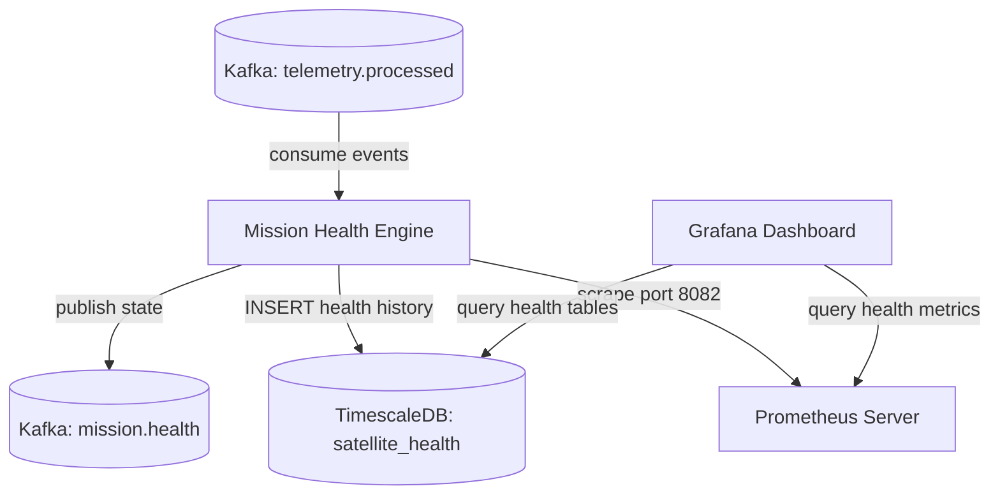
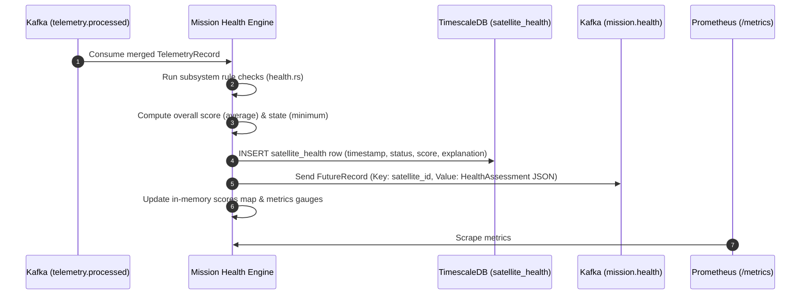

# Phase 2: Mission Health Engine Architecture & Design
### Version: v4.0.0 (Latest)

This document details the architecture, design, health rules, and operational integrations for the Mission Health Engine of **OrbitLogs**.

---

## 1. System Context & Flow

The `mission-health-engine` is an event-driven service that consumes fully merged, processed telemetry from the `telemetry.processed` Kafka topic. It evaluates the raw parameters of each subsystem, determines their operational health status (GREEN, YELLOW, RED), saves a structured status record to TimescaleDB, publishes the assessment to the `mission.health` Kafka topic, and updates real-time Prometheus metrics.

### Component Diagram

---

## 2. Telemetry Assessment Sequence

---

## 3. Subsystem Health Evaluation Rules

The health state rules map raw telemetry parameters to SRE operational states:

| Subsystem | Health Status | Assessment Thresholds | Score | Status Description |
| :--- | :--- | :--- | :--- | :--- |
| **Power** | `RED` | Battery voltage < 10.0V or > 16.0V | 0 | "Critical battery voltage: [V]" |
| | `YELLOW` | Battery voltage < 11.5V | 50 | "Low battery voltage: [V]" |
| | `GREEN` | Otherwise | 100 | "Power system normal ([V])" |
| **Thermal** | `RED` | Temperature < -20.0°C or > 85.0°C | 0 | "Critical temperature: [T]°C" |
| | `YELLOW` | Temperature < 0.0°C or > 60.0°C | 50 | "Elevated temperature: [T]°C" |
| | `GREEN` | Otherwise | 100 | "Thermal system normal ([T]°C)" |
| **Communications**| `RED` | Loss > 15%, Latency > 2s, or Signal < -110dBm | 0 | "Critical comm degradation" |
| | `YELLOW` | Loss > 5%, Latency > 800ms, or Signal < -95dBm | 50 | "Comm degradation" |
| | `GREEN` | Otherwise | 100 | "Communications normal" |
| **Propulsion** | `RED` | Fuel < 5.0% or Altitude < 150 km | 0 | "Critical propulsion/orbital decay" |
| | `YELLOW` | Fuel < 20.0% or Altitude < 300 km | 50 | "Propulsion degraded/low orbit" |
| | `GREEN` | Otherwise | 100 | "Propulsion normal" |
| **ADCS** | `RED` | Pitch, Roll, or Yaw drift > 45.0° | 0 | "Critical attitude drift" |
| | `YELLOW` | Pitch, Roll, or Yaw drift > 15.0° | 50 | "Attitude drift" |
| | `GREEN` | Otherwise | 100 | "ADCS control loop nominal" |
| **Payload** | `RED` | Active & draw > 30W; or Inactive with V > 11.5V | 0 | "Payload short/inactive status error" |
| | `YELLOW` | Inactive with V <= 11.5V; or Active & draw > 20W | 50 | "Payload shutdown/elevated draw" |
| | `GREEN` | Otherwise | 100 | "Payload operating normally" |
| **Flight Computer**| `RED` | CPU > 95.0% or Memory > 95.0% | 0 | "Critical flight computer load" |
| | `YELLOW` | CPU > 80.0% or Memory > 80.0% | 50 | "High flight computer load" |
| | `GREEN` | Otherwise | 100 | "Flight computer operational" |

### Aggregation Rules:
- **Satellite Overall State**: Evaluated as the **minimum** state of all 7 subsystems (i.e. any `RED` triggers `RED` overall, any `YELLOW` triggers `YELLOW` overall, `GREEN` only if all subsystems are `GREEN`).
- **Satellite Overall Score**: Calculated as the **average** score of all 7 subsystems, mapping to a smooth `0-100` range for metrics charting.
- **Fleet Health Index**: Calculated in real-time as the average of the overall scores of all satellites in the fleet.

---

## 4. Observability & Dashboarding

The engine exposes Prometheus metrics at `:8082/metrics`:
- `fleet_health_score`: Real-time Fleet Health Index.
- `satellite_health_score{satellite_id="..."}`: Per-satellite health score.
- `subsystem_health_score{satellite_id="...", subsystem_id="..."}`: Per-subsystem health score.

These metrics and the TimescaleDB `satellite_health` table power the **OrbitLogs - Fleet & Mission Health** Grafana dashboard to allow operators to monitor spacecraft status by operational health, trace incidents chronologically, and drill down on subsystem status.
