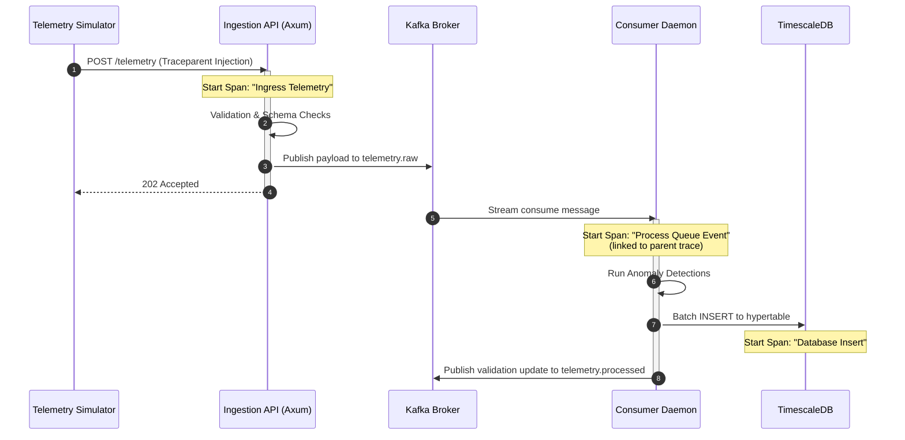

# Open SpaceOps: System Architecture & Distributed Systems Design

This document details the engineering specifications, data flow, failure handling modes, and architectural trade-offs made in the design of the **Open SpaceOps** platform.

---

## 1. System Topology Overview

Open SpaceOps decouples the real-time high-throughput telemetry ingestion from database persistence through a key-based partitioned **Apache Kafka** event stream. This guarantees that API endpoint spikes never degrade system performance or result in dropped metrics.

```
       [ Telemetry Simulator ]
                  │ (POST /telemetry JSON)
                  ▼
       [ Ingestion Tier (Axum API) ] ──(Spans: Trace Ingress)
                  │
                  ├─(Validation & Enrichment)
                  │
                  ▼ (Produce to Keyed Partition)
       [ Kafka Queue (telemetry.raw) ] ──(Partitioned by satellite_id)
                  │
                  ▼ (Subscribe / Stream Consume)
     [ Consumer Tier (Tokio Processor) ] ──(Spans: Trace Persistence)
                  │
                  ├─(Rule-Based Anomaly Detection)
                  │
                  ├──► (Upsert Anomaly) ──► [ TimescaleDB events ]
                  │
                  └──► (Batch Write)  ──► [ TimescaleDB telemetry ]
```

---

## 2. Telemetry Ingestion & Serialization Pipeline

### Ingestion Flow
1. **HTTP Ingress**: The Rust Axum server listens on `:8080/telemetry`. It operates in an asynchronous loop, utilizing `tokio` multi-threaded task stealing.
2. **Payload Validation**: Incoming telemetry is checked against physical parameters (such as limits on battery charges, orientation angles, and timestamps).
   - If invalid, the payload is immediately serialized as a rejection log and published to `telemetry.invalid` (Dead Letter Queue) for SRE diagnostic analysis.
3. **Kafka Produce**: Valid payloads are enriched with a processing `received_at` date and a tracking `event_id` UUID, and queued onto the `telemetry.raw` topic using a key-based partition strategy (keyed by `satellite_id`).
4. **Immediate Acceptance**: The server returns an HTTP `202 Accepted` status with the `event_id` in less than **5ms**, avoiding blocking on downstream writes.

---

## 3. Distributed Tracing & Trace Propagation

Distributed tracing is fully instrumented using **OpenTelemetry (OTLP)**. Spans are correlated across process boundaries:



---

## 4. Failure Modes & Self-Healing Design

The platform is designed to operate under partial network or database degradation:

### Database Downtime (Self-Healing Ingester)
If TimescaleDB becomes unreachable or locked, the consumer loop employs an **exponential backoff retry strategy**:
- **First Failure**: Retries in 100ms.
- **Subsequent Failures**: Retries double sequentially (200ms -> 400ms -> 800ms) up to 3 attempts.
- **Fallback Dead-Letter Route**: If the database write continues to fail after all attempts, the message is routed to `telemetry.invalid` along with its persistence stack trace. The consumer then commits the Kafka offset and continues parsing the queue to prevent pipeline stalling.

### Backpressure Handling
If the Kafka broker cannot keep up with simulator generation speeds:
- The Axum producer layer utilizes a non-blocking queue. If Kafka buffers become full, Axum applies backpressure by rejecting incoming HTTP connections with a `503 Service Unavailable`, protecting collector RAM from overflow.

---

## 5. Architectural Trade-offs & Decisions

### Why Rust instead of Go/Java?
- **Zero Garbage Collection (GC)**: Telemetry systems must handle millions of tiny time-series payloads. Go/Java GC sweeps create latency spikes (p99 degradation). Rust's compile-time borrow checker guarantees flat, deterministic execution speed.
- **Memory Efficiency**: Rust processes require <20MB of resident RAM, allowing massive scale-out deployment in resource-constrained edge gateways.

### Why key-based partitioning in Kafka?
- Using the `satellite_id` as the message key guarantees that all telemetry for a given satellite will land on the **same partition**. Since Kafka guarantees order within a partition, this ensures that the database ingester parses and inserts telemetry for each satellite in strict chronological sequence, preventing time-drift anomalies.
