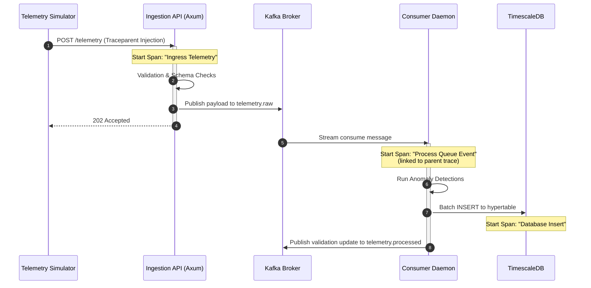

# 🛰️ OrbitLogs: System Architecture & Distributed Systems Design
### Version: v4.0.0 (Latest)

This document details the engineering specifications, data flow, failure handling modes, and architectural decisions of the **OrbitLogs** real-time spacecraft ground segment operations platform.

---

## 1. System Topology Overview

OrbitLogs decouples real-time high-throughput telemetry ingestion from database persistence through a key-based partitioned **Apache Kafka** event stream running on a 3-broker KRaft cluster. In v4.0.0, the architecture is expanded to include a dedicated **Orbit Operations Service** (`orbit-ops-service`) managing SGP4 orbit propagation, TLE records, ground station pass schedules, and collision avoidance dynamics.

```
       [ Telemetry Simulator ] ──(SGP4 Propagated Lat/Lon)
                  │ (POST /telemetry binary CCSDS or JSON)
                  ▼
       [ Ingestion Tier (Axum API) ] ──(Spans: Trace Ingress, JWT Authorized)
                  │
                  ├─(Validation & CRC-16 Checksum Verification)
                  │
                  ▼ (Produce to Keyed Partition)
       [ Kafka Queue (telemetry.raw) ] ──(Partitioned by satellite_id)
                  │
                  ├─► [ Consumer Tier (Tokio Processor) ]
                  │          │
                  │          ├──► (Stateful LRU Merging)
                  │          ├──► (Run Anomaly Verification)
                  │          └──► [ TimescaleDB telemetry ]
                  │
                  ▼ (Consumer loop updates)
       [ Kafka Queue (telemetry.processed) ]
                  │
                  ├─► [ Mission Health Engine ] ──► [ TimescaleDB health ]
                  │
                  └─► [ Orbit Operations Service ]
                             │
                             ├─► (Closed-Loop Command Verification)
                             ├─► (Conjunction Debris Evaluation)
                             └─► [ TimescaleDB orbit_positions ]
```

---

## 2. Telemetry Ingestion & Serialization Pipeline

### Ingestion Flow
1.  **Multi-Format Ingress**: The Axum server in [telemetry-collector](file:///c:/Users/bikrams/orbitlogs/OrbitLOgs/apps/telemetry-collector/src/main.rs) ingests data on `:8080/telemetry`. It supports JSON payloads and CCSDS-inspired binary packet streams when `Content-Type: application/octet-stream` is specified.
2.  **CRC-16 Checksum Validation**: Binary packets are parsed via the `orbitlogs-packets` crate, verifying their CRC-16-CCITT checksums to guarantee integrity over simulated space links.
3.  **Schema Registry Check**: Validates payloads against V1 (Legacy), V2 (Standard), and V3 (Extended) formats using `space-schema-registry` rules.
4.  **Kafka Queue**: Valid payloads are enriched and queued onto the `telemetry.raw` topic using a key-based partition strategy (keyed by `satellite_id`).
5.  **Rejection Quarantine (DLQ)**: Failing payloads are wrapped in a diagnostic JSON envelope and routed to `telemetry.invalid`.

---

## 3. Distributed Tracing & Trace Propagation

Distributed tracing is fully instrumented using **OpenTelemetry (OTLP)**. Spans are correlated across process boundaries:



---

## 4. Failure Modes & Self-Healing Design

### Database Downtime (Self-Healing Ingester)
If TimescaleDB becomes unreachable or locked, the consumer loop employs an **exponential backoff retry strategy**:
- **First Failure**: Retries in 100ms.
- **Subsequent Failures**: Retries double sequentially (200ms -> 400ms -> 800ms) up to 3 attempts.
- **Fallback Dead-Letter Route**: If the database write continues to fail after all attempts, the message is routed to `telemetry.invalid` along with its persistence stack trace. The consumer then commits the Kafka offset and continues parsing the queue to prevent pipeline stalling.

### Backpressure Handling
If the Kafka broker cannot keep up with simulator generation speeds:
- The Axum producer layer utilizes a non-blocking queue. If Kafka buffers become full, Axum applies backpressure by rejecting incoming HTTP connections with a `503 Service Unavailable`, protecting collector RAM from overflow.

---

## 5. Architectural Trade-offs & Decisions

### Why Rust instead of Go/Java?
- **Zero Garbage Collection (GC)**: Telemetry systems must handle millions of tiny time-series payloads. Go/Java GC sweeps create latency spikes (p99 degradation). Rust's compile-time borrow checker guarantees flat, deterministic execution speed.
- **Memory Efficiency**: Rust processes require <20MB of resident RAM, allowing massive scale-out deployment in resource-constrained edge gateways.

### Why key-based partitioning in Kafka?
- Using `{mission_id}:{satellite_id}` as the message key guarantees that all telemetry for a given satellite in a specific mission will land on the **same partition**. Since Kafka guarantees order within a partition, this ensures that the database ingester parses and inserts telemetry for each satellite in strict chronological sequence, preventing time-drift anomalies. Furthermore, including the `mission_id` in the partition key enables scaling and multi-mission fleet isolation inside the same Kafka cluster, allowing consumers to filter and route by mission or isolate processors.
