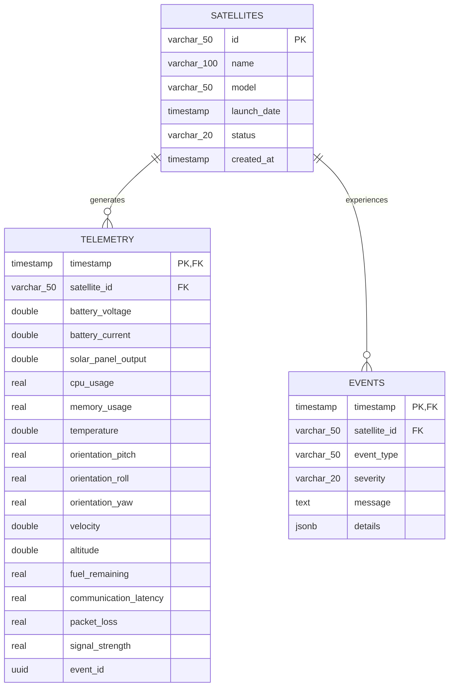

# Open SpaceOps: TimescaleDB Database Design & Hardening

This document outlines the time-series optimizations, hypertable configurations, compression indexes, and data retention policies designed to store millions of high-velocity telemetry logs.

---

## 1. Relational Schema & Entity-Relationship Model

The database isolates static metadata from high-velocity time-series datasets using three main tables:

---

## 2. Hypertable Time-Partitioning

Both `telemetry` and `events` tables are converted into TimescaleDB **Hypertables**:
- **Partition Key**: `timestamp` column.
- **Chunk Interval**: `1 day` intervals.
- **Rationale**: By partitioning data into daily chunks, PostgreSQL indexes are kept small enough to fit completely in RAM. New writes land on the active chunk, preventing disk-thrashing index updates.

---

## 3. High-Ratio Compression Policy

To save disk space on millions of older rows, TimescaleDB compression is configured:
- **Segmentation Key**: `satellite_id` (data is grouped together per satellite).
- **Ordering Key**: `timestamp DESC` (highly compressible delta-delta sorting).
- **Policy**: Auto-compresses daily chunks older than **7 days**.
- **Results**: Saves up to **90%+** on disk footprint, allowing millions of historical telemetry metrics to be stored on standard storage systems.

---

## 4. Automatic Retention Policies

Space telemetry grows exponentially. To prevent disk overflow:
- **Telemetry Retention**: Auto-drops chunks older than **90 days**.
- **Events Retention**: Auto-drops chunks older than **180 days** (critical event histories are preserved longer for SRE post-mortems).
