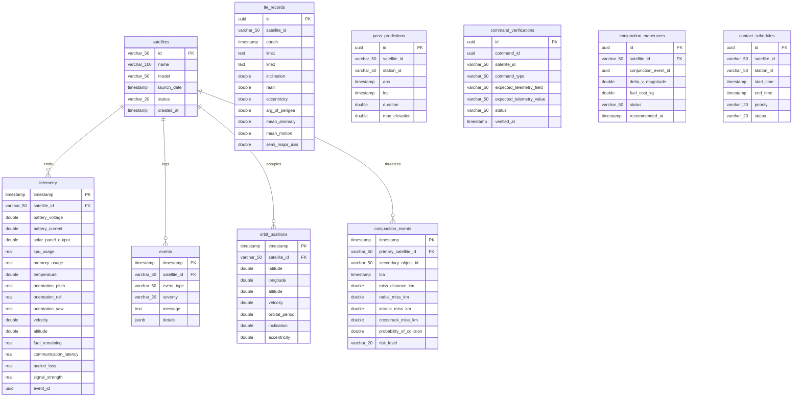

# OrbitLogs: TimescaleDB Database Design & Hardening
### Version: v4.5.0 (Latest)

This document details the database schema, time-series optimizations, hypertable configurations, compression indices, and data retention policies of **OrbitLogs**.

---

## 1. Relational Schema & Hypertables

OrbitLogs utilizes **TimescaleDB** to split telemetry and events into time-partitioned hypertables, while maintaining relational integrity for metadata tables.

---

## 2. Hypertable Time-Partitioning

The following high-throughput tables are converted to TimescaleDB hypertables:
*   `telemetry` (Partitioned on `timestamp`, interval: `1 day`)
*   `events` (Partitioned on `timestamp`, interval: `1 day`)
*   `orbit_positions` (Partitioned on `timestamp`, interval: `1 day`)

By keeping chunk intervals to 1 day, index lookups remain small enough to fit within available RAM, preventing disk-thrashing bottlenecks during telemetry inserts.

---

## 3. High-Ratio Compression Policy

To optimize disk footprint, TimescaleDB compression is configured:
*   **Segmentation Key**: `satellite_id` (data is grouped together per satellite).
*   **Ordering Key**: `timestamp DESC` (enables delta-delta compression).
*   **Policy**: Automatically compresses chunks older than **7 days**.
*   **Results**: Reduces disk footprints by **90%**, optimizing historical analysis.

---

## 4. Automatic Retention Policies

To protect against storage blowout, data retention policies are enforced:
*   **Telemetry Retention**: Automatically drops chunks older than **90 days**.
*   **Events Retention**: Drops chunks older than **180 days** to preserve incident logs for SRE audits.
*   **Orbit Positions Retention**: Automatically drops chunks older than **30 days** (relying on raw TLE files for long-term orbital regressions).

---

## 5. Continuous Aggregates

To prevent CPU exhaustion during heavy Grafana dashboard queries, TimescaleDB **Continuous Aggregates** pre-calculate hourly averages of key telemetry metrics:

*   `hourly_battery_avg`: Average `battery_voltage` per satellite per hour.
*   `hourly_solar_avg`: Average `solar_panel_output` per satellite per hour.
*   `hourly_cpu_avg`: Average `cpu_usage` per satellite per hour.
*   `hourly_temperature_avg`: Average `temperature` per satellite per hour.
*   `hourly_altitude_avg`: Average `altitude` per satellite per hour.

These materialized views are defined in migration `20260101000011_continuous_aggregates.sql` and refreshed automatically by TimescaleDB policies.
