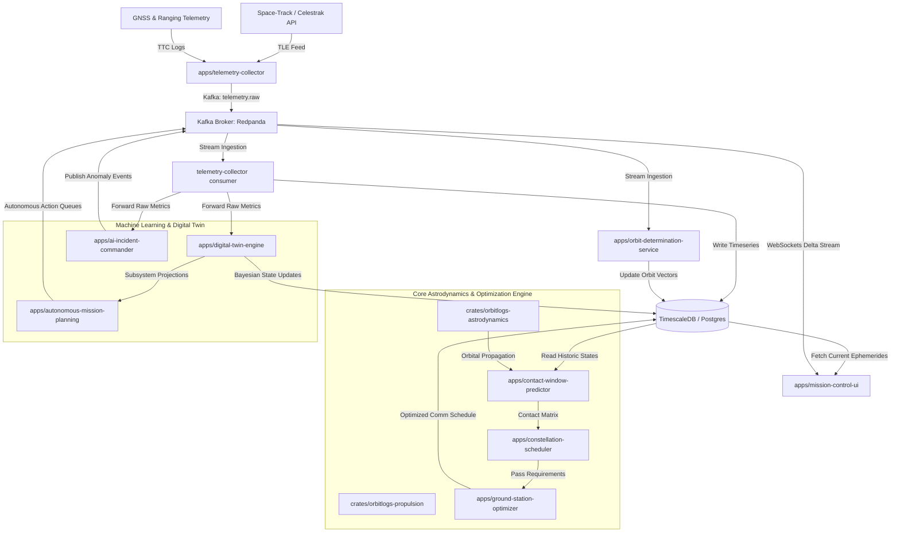

# SpaceX Starlink Next-Gen Constellation Management: System Architecture Proposal

> **Status: ✅ All 10 features have been implemented** as of v4.5.0. The workspace now includes all proposed applications and library crates described below. This document is preserved as the original design specification.

This proposal outlines the engineering design and implementation plan for integrating advanced astrodynamics, optimization, machine learning, and autonomous operations into the **OrbitLogs** platform. 

As a Staff Engineer at SpaceX Starlink, the focus is on **scalability** (handling $10,000+$ satellites and dozens of ground stations), **mathematical rigor** (astrodynamics, optimal control), and **resilient software engineering** (Rust, axum, Kafka/Redpanda, and TimescaleDB).

---

## 1. System Architecture Overview

The diagram below illustrates how the 10 requested features integrate into the existing microservices and shared libraries of the Cargo workspace:



---

## 2. Deep-Dive Design of the 10 Next-Gen Features

### Feature 1: Real TLE Ingestion
**Problem**: The current system simulates orbital phase decay via simple linear formulas. We need to ingest real Two-Line Element (TLE) sets from Space-Track or Celestrak to track actual spacecraft trajectories.
**Implementation**:
*   **Module**: Create a new ingestion worker in `apps/telemetry-collector` or a dedicated cron job.
*   **Astrodynamics Core**: Pull in the `sgp4` and `chrono` crates. Parse the standard 3-line format (Title + 2 lines of elements).
*   **Database Schema**: Define a `satellite_tles` table inside TimescaleDB containing:
    *   `satellite_id` (PK)
    *   `epoch` (Timestamp with timezone, PK)
    *   `line1` (VARCHAR(69))
    *   `line2` (VARCHAR(69))
    *   `eccentricity`, `inclination`, `raan`, `arg_of_perigee`, `mean_anomaly`, `mean_motion`.

#### Rust Code Structure (`crates/orbitlogs-astrodynamics/src/tle.rs`)
```rust
use chrono::{DateTime, Utc};
use sgp4::{Elements, Orbiter};
use serde::{Serialize, Deserialize};

#[derive(Debug, Clone, Serialize, Deserialize)]
pub struct TleRecord {
    pub satellite_id: String,
    pub epoch: DateTime<Utc>,
    pub line1: String,
    pub line2: String,
}

impl TleRecord {
    /// Validates the lines and parses Keplerian components using the SGP4 crate.
    pub fn to_elements(&self) -> Result<Elements, sgp4::Error> {
        Elements::from_lines(
            Some(self.satellite_id.clone()),
            &self.line1,
            &self.line2
        )
    }

    /// Propagates the orbit to a target time, returning position and velocity in ECI (TEME).
    pub fn propagate_to(&self, target_time: DateTime<Utc>) -> Result<([f64; 3], [f64; 3]), sgp4::Error> {
        let elements = self.to_elements()?;
        let orbiter = Orbiter::from_elements(elements)?;
        
        // Calculate minutes since epoch
        let delta_minutes = target_time.signed_duration_since(self.epoch).num_seconds() as f64 / 60.0;
        let prediction = orbiter.propagate(delta_minutes)?;
        
        Ok((prediction.position, prediction.velocity))
    }
}
```

---

### Feature 2: Live Satellite Visualization
**Problem**: Rendering 10,000+ satellites on a 3D Earth in real-time can choke the network if coordinate vectors ($x, y, z$) are sent down at $1\text{ Hz}$ frequency.
**Implementation**:
1.  **Client-Side Propagation**: Compile the `orbitlogs-astrodynamics` crate to WebAssembly (`wasm-bindgen`).
2.  **State Synchronization**: Send TLE parameters and epoch coordinates to the UI (`apps/mission-control-ui`) *once* per orbital shift, or on cache miss. 
3.  **Visualization Render Loop**: The client browser executes the SGP4 propagation locally inside a RequestAnimationFrame loop (using CesiumJS or Deck.gl/three.js), avoiding server load.
4.  **Delta Compression over WebSockets**: The server only streams real-time deviations (e.g., active thruster burns, collision avoidance overrides, or subsystem failures) via WebSocket:

```rust
#[derive(Debug, Serialize, Deserialize)]
pub enum VisualDeltaMessage {
    ManeuverStarted {
        satellite_id: String,
        delta_v: [f32; 3],
        duration_secs: u32,
    },
    TelemetryAnomaly {
        satellite_id: String,
        severity: String, // 'CRITICAL', 'WARNING'
    },
}
```

---

### Feature 3: ML Anomaly Detection
**Problem**: Static rule thresholds (like `temp > 60.0` in `director.rs`) cannot catch complex, multi-variate correlations that precede structural breakdowns (e.g., a subtle voltage drop coinciding with high reaction wheel current).
**Implementation**:
*   **Module**: Implement as a consumer in `apps/ai-incident-commander` using the `ort` (ONNX Runtime) crate.
*   **Model**: Train a multi-sensor Autoencoder (LSTM or fully-connected) in Python using PyTorch, export it to ONNX.
*   **Operation**: Feed raw telemetry (10 dimensions: battery_v, battery_i, temp, pitch_drift, signal, etc.) through the model. If the reconstruction loss $L = ||x - \hat{x}||_2^2$ exceeds a dynamic, subsystem-dependent threshold, raise an anomaly.

#### ONNX Runner Core in Rust
```rust
use ort::{Environment, SessionBuilder, Value};
use std::sync::Arc;

pub struct AnomalyDetector {
    session: ort::Session,
}

impl AnomalyDetector {
    pub fn new(model_path: &str) -> Result<Self, ort::Error> {
        let env = Arc::new(Environment::builder().with_name("StarlinkAnomalyML").build()?);
        let session = SessionBuilder::new(&env)?
            .with_optimization_level(ort::GraphOptimizationLevel::Level3)?
            .with_model_from_file(model_path)?;
        Ok(Self { session })
    }

    pub fn predict(&self, features: &[f32; 10]) -> Result<bool, ort::Error> {
        let input_tensor = Value::from_array(
            self.session.allocator(),
            ndarray::Array2::from_shape_vec((1, 10), features.to_vec()).unwrap()
        )?;
        
        let outputs = self.session.run(ort::inputs![input_tensor]?)?;
        let output_tensor = outputs[0].extract_tensor::<f32>()?;
        
        // Calculate Reconstruction Loss (MSE)
        let loss: f32 = features.iter()
            .zip(output_tensor.view().iter())
            .map(|(&orig, &recon)| (orig - recon).powi(2))
            .sum::<f32>() / 10.0;

        Ok(loss > 0.05) // Threshold tuned to capture anomalous variance
    }
}
```

---

### Feature 4: Constellation Scheduler
**Problem**: Allocating satellite communication tasks (downlinking logs, routing customer packet streams, cross-link routing) is a high-dimensional, NP-hard scheduling problem.
**Implementation**:
*   **Algorithm**: Frame this as a **Mixed-Integer Linear Programming (MILP)** model or a high-performance **Greedy Heuristic with Look-Ahead**.
*   **Constraints**:
    *   *Slew-Rate Constraint*: Antennas require time $\Delta t_{slew}$ to steer from one satellite to another.
    *   *Thermal & Power Budgets*: Transmitting draws power; payload cannot exceed max solar panel accumulation.
    *   *No-Overlap*: A single terminal cannot lock onto two satellites simultaneously.
*   **Module**: Create `apps/constellation-scheduler`.

```rust
#[derive(Debug)]
pub struct TaskRequest {
    pub satellite_id: String,
    pub priority: u8,
    pub data_volume_gb: f64,
    pub time_window: (DateTime<Utc>, DateTime<Utc>),
}

pub struct ScheduleSolution {
    pub satellite_id: String,
    pub ground_station_id: String,
    pub start_time: DateTime<Utc>,
    pub duration_secs: u32,
}
```

---

### Feature 5: Ground Station Optimizer
**Problem**: Dynamic atmospheric attenuation (rain, clouds) and localized antenna failures reduce scheduled link margins.
**Implementation**:
*   **Dynamic Channel Modeling**: Implement the ITU-R P.618 rain attenuation calculation. If local weather forecasts show active rain, degrade the predicted signal-to-noise ratio ($E_b/N_0$).
*   **Dynamic Handover Routing**: The optimizer coordinates handovers between satellites and antennas using a flow network algorithm (e.g., Min-Cost Max-Flow).

```rust
pub struct GroundStationAntenna {
    pub id: String,
    pub min_elevation_angle: f32, // Degrees (typically 10-25)
    pub max_slew_rate: f32,       // Degrees/sec
    pub operational_status: String,
}

impl GroundStationAntenna {
    pub fn calculate_path_loss(&self, distance_km: f64, frequency_ghz: f64, rain_rate_mm_h: f64) -> f64 {
        let free_space_loss = 20.0 * distance_km.log10() + 20.0 * frequency_ghz.log10() + 92.44;
        let rain_loss = 0.05 * rain_rate_mm_h.powf(1.15) * distance_km; // Simplified rain fade model
        free_space_loss + rain_loss
    }
}
```

---

### Feature 6: Contact Window Prediction
**Problem**: We must pre-compute precise visibility windows between ground stations (fixed WGS84 positions) and orbiting satellites (ECI coordinates propagated via SGP4).
**Implementation**:
1.  **Coordinate Transformation**: Convert satellite ECI position ($x_{ECI}, y_{ECI}, z_{ECI}$) to ECEF ($x_{ECEF}, y_{ECEF}, z_{ECEF}$) by applying the Greenwich Mean Sidereal Time (GMST) rotation matrix.
2.  **Elevation Angle Check**: Transform the relative position vector to the Ground Station's local East-North-Up (ENU) coordinate system. The elevation angle $\beta$ must exceed the station's elevation mask:

$$\sin(\beta) = \frac{\mathbf{p}_{ENU} \cdot \mathbf{u}_z}{\|\mathbf{p}_{ENU}\|}$$

```rust
pub struct ContactWindow {
    pub satellite_id: String,
    pub ground_station_id: String,
    pub start_time: DateTime<Utc>,
    pub end_time: DateTime<Utc>,
    pub max_elevation: f32,
}

pub fn predict_contact_windows(
    tle: &TleRecord,
    station_lat: f64,
    station_lon: f64,
    station_alt: f64,
    start: DateTime<Utc>,
    end: DateTime<Utc>
) -> Vec<ContactWindow> {
    let mut windows = Vec::new();
    let mut step = start;
    let mut active_window: Option<ContactWindow> = None;

    while step < end {
        let (pos_eci, _) = tle.propagate_to(step).unwrap();
        let pos_ecef = eci_to_ecef(pos_eci, step);
        let elevation = calculate_elevation(pos_ecef, station_lat, station_lon, station_alt);

        if elevation > 10.0 { // 10 degree mask
            if let Some(ref mut win) = active_window {
                win.end_time = step;
                if elevation > win.max_elevation {
                    win.max_elevation = elevation as f32;
                }
            } else {
                active_window = Some(ContactWindow {
                    satellite_id: tle.satellite_id.clone(),
                    ground_station_id: "GS-0001".to_string(), // Dynamic
                    start_time: step,
                    end_time: step,
                    max_elevation: elevation as f32,
                });
            }
        } else if let Some(win) = active_window.take() {
            windows.push(win);
        }

        step = step + chrono::Duration::seconds(30); // 30-second steps
    }
    windows
}

// Helpers for frame conversion (ECI -> ECEF -> ENU) omitted for brevity
fn eci_to_ecef(eci: [f64; 3], time: DateTime<Utc>) -> [f64; 3] { todo!() }
fn calculate_elevation(ecef: [f64; 3], lat: f64, lon: f64, alt: f64) -> f64 { todo!() }
```

---

### Feature 7: Orbit Determination (OD)
**Problem**: SGP4 is too inaccurate for precise operations (collision avoidance maneuvers require centimeter-to-meter-level accuracy).
**Implementation**:
*   **Module**: Create `apps/orbit-determination-service`.
*   **Algorithm**: Implement an **Extended Kalman Filter (EKF)** or Batch Least Squares (BLS).
*   **State Vector**: $\mathbf{x} = [x, y, z, v_x, v_y, v_z]^T$ (Position and Velocity).
*   **Observation**: GPS pseudorange measurements and ground-station range/range-rate measurements from telemetry packets.
*   **Perturbations**: Include J2 oblateness, atmospheric drag (MSISE-90 model), and solar radiation pressure.

```rust
use nalgebra::{DMatrix, DVector};

pub struct ExtendedKalmanFilter {
    pub state: DVector<f64>, // [x, y, z, vx, vy, vz]
    pub covariance: DMatrix<f64>,
}

impl ExtendedKalmanFilter {
    pub fn predict(&mut self, dt: f64) {
        // Propagate state using Keplerian equations + J2 perturbations
        let f = numerical_orbital_dynamics(&self.state, dt);
        let jacobian = calculate_transition_matrix(&self.state, dt);
        
        self.state = f;
        self.covariance = &jacobian * &self.covariance * jacobian.transpose(); // + Q (Process Noise)
    }

    pub fn update(&mut self, z: &DVector<f64>, r: &DMatrix<f64>) {
        // Measurement Update: Update state vector based on GPS observations
        let h = observation_model(&self.state);
        let h_jacobian = calculate_observation_jacobian(&self.state);
        
        let y = z - &h; // Measurement residual
        let s = &h_jacobian * &self.covariance * h_jacobian.transpose() + r;
        let k = &self.covariance * h_jacobian.transpose() * s.try_inverse().unwrap(); // Kalman Gain

        self.state = &self.state + &k * y;
        let identity = DMatrix::<f64>::identity(6, 6);
        self.covariance = (identity - &k * h_jacobian) * &self.covariance;
    }
}

fn numerical_orbital_dynamics(state: &DVector<f64>, dt: f64) -> DVector<f64> { todo!() }
fn calculate_transition_matrix(state: &DVector<f64>, dt: f64) -> DMatrix<f64> { todo!() }
fn observation_model(state: &DVector<f64>) -> DVector<f64> { todo!() }
fn calculate_observation_jacobian(state: &DVector<f64>) -> DMatrix<f64> { todo!() }
```

---

### Feature 8: Fuel Optimization
**Problem**: Station keeping and collision avoidance (COLA) burns exhaust cold-gas/krypton fuel, directly dictating spacecraft operational lifespan.
**Implementation**:
*   **Dynamics**: Leverage the Tsiolkovsky rocket equation:

$$\Delta V = I_{sp} g_0 \ln\left(\frac{m_{start}}{m_{final}}\right)$$

*   **Optimizer**: Optimize impulsive or low-thrust maneuvers. Station-keeping uses sparse orbital maneuvers (as highlighted in `director.rs`'s `CMD_PROP_SPARSE_CYCLE_ENABLE`).
*   **Goal**: Minimize total integrated fuel mass $\int \dot{m} dt$ while meeting safety clearance parameters (e.g. keeping collision probability $P_{collision} < 10^{-6}$).

```rust
pub struct ManeuverPlan {
    pub sat_id: String,
    pub burn_epoch: DateTime<Utc>,
    pub delta_v_vector: [f64; 3], // ECI coordinate velocity adjustments (m/s)
    pub fuel_consumed_kg: f32,
}

impl ManeuverPlan {
    pub fn calculate_maneuver(
        sat_mass: f32,
        isp_seconds: f32,
        required_dv: [f64; 3]
    ) -> Self {
        let g0 = 9.80665;
        let dv_mag = (required_dv[0].powi(2) + required_dv[1].powi(2) + required_dv[2].powi(2)).sqrt();
        let mass_ratio = (-dv_mag / (isp_seconds as f64 * g0)).exp();
        let fuel_mass = sat_mass * (1.0 - mass_ratio as f32);

        Self {
            sat_id: "SAT-GENERIC".to_string(),
            burn_epoch: Utc::now(),
            delta_v_vector: required_dv,
            fuel_consumed_kg: fuel_mass,
        }
    }
}
```

---

### Feature 9: Digital Twin Learning
**Problem**: Static simulation equations in `apps/digital-twin-engine/src/simulation.rs` drift over time. Real hardware experiences solar array solar degradation, battery capacity fade, and valve stickiness.
**Implementation**:
*   **Recursive Parameter Estimation**: Create a state-parameter observer (Dual EKF or recursive Bayesian update).
*   **Parameters Tracked**:
    *   *Solar Panel Efficiency ($S_{eff}$)*: Degradation over time, modeled as $S_{eff} \leftarrow S_{eff} \cdot (1 - \gamma_{deg} \cdot dt)$.
    *   *Battery Capacity Factor ($C_{fade}$)*: Track aging coefficients dynamically.
    *   *Radiator Thermal Resistance ($R_{th}$)*: Track structural build-ups or micrometeoroid degradation.

```rust
#[derive(Debug, Serialize, Deserialize)]
pub struct DigitalTwinState {
    pub satellite_id: String,
    pub solar_efficiency: f32,
    pub battery_capacity_fade: f32,
    pub radiator_thermal_resistance: f32,
}

impl DigitalTwinState {
    /// Recursively updates parameters based on actual solar generation telemetry.
    pub fn estimate_solar_efficiency(&mut self, actual_solar_w: f32, solar_exposure_factor: f32) {
        if solar_exposure_factor > 0.1 {
            let theoretical_max = 120.0 * solar_exposure_factor; // nominal maximum output
            let observed_efficiency = actual_solar_w / theoretical_max;
            
            // Apply recursive low-pass filter (learning factor alpha = 0.001)
            self.solar_efficiency = 0.999 * self.solar_efficiency + 0.001 * observed_efficiency;
        }
    }
}
```

---

### Feature 10: Autonomous Mission Planning
**Problem**: Ground operators cannot manually resolve conflicts or write command sequences when reacting to orbital anomalies across 10,000+ satellites.
**Implementation**:
*   **Structure**: Add a runtime library in `apps/autonomous-mission-planning`.
*   **Engine**: Use a **Hierarchical Task Network (HTN)** or **Temporal Action Graph Planner** to synthesize command scripts.
*   **Safe-to-Execute Check**: Run all proposed commands through the localized `digital-twin-engine` *prior* to uplink transmission.

```rust
#[derive(Debug, Clone, Serialize, Deserialize)]
pub enum Command {
    ShedSecondaryLoad,
    AdjustRadiatorYaw { angle_degrees: f32 },
    OrientSolarPanels { heading_degrees: f32 },
    ExecuteBurn { vector: [f64; 3] },
}

pub struct OnboardTimeline {
    pub schedule: Vec<(DateTime<Utc>, Command)>,
}

impl OnboardTimeline {
    /// Runs a simulation check to ensure no commands violate flight constraints (e.g. power draining).
    pub fn validate_safety_constraints(&self, twin: &DigitalTwinState) -> Result<(), &'static str> {
        let mut simulated_battery = 100.0;
        
        for (_time, cmd) in &self.schedule {
            match cmd {
                Command::ExecuteBurn { .. } => {
                    simulated_battery -= 25.0; // Heavy discharge for thruster actuators
                }
                Command::ShedSecondaryLoad => {
                    simulated_battery += 5.0;
                }
                _ => {}
            }
            if simulated_battery < 20.0 {
                return Err("Constraint Violated: Battery capacity dropped below critical safe threshold during execution.");
            }
        }
        Ok(())
    }
}
```

---

## 3. Recommended Workspace File Structural Modifications

To construct these next-gen features, the Cargo workspace should expand with these modules:

```diff
  OrbitLogs/
  ├── apps/
  │   ├── ai-incident-commander/       # Extends to consume telemetry.raw and run ONNX Autoencoders
  │   ├── digital-twin-engine/         # Incorporates the Bayesian parameter estimators
  │   ├── orbit-ops-service/           # Implements the WebSocket API for Delta Visualizer streaming
  │   ├── contact-window-predictor/    # Background microservice calculating access windows
  │   ├── constellation-scheduler/     # Task scheduling & ground-station optimizer worker
  │   ├── orbit-determination-service/ # Extended Kalman Filtering engine for raw GNSS input
  │   ├── autonomous-mission-planning/ # Hierarchical Task Network command planner
  │   └── ...
  ├── crates/
  │   ├── orbitlogs-models/            # Exposes schemas for TleRecord, ContactWindow, DigitalTwinState
  │   ├── orbitlogs-astrodynamics/     # Core frame conversions (ECI/ECEF/ENU) and SGP4 propagation
  │   ├── orbitlogs-propulsion/        # Thruster optimization and delta-v burn calculations
  │   ├── orbitlogs-test-utils/        # Centralized test fixture factories and mock builders
  │   └── ...
```

