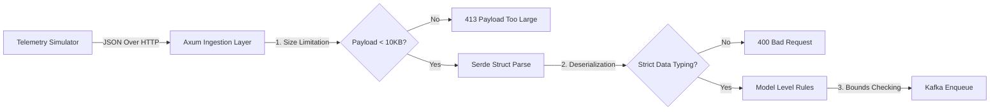

# Open SpaceOps: Security Practices & Hardening Guide

This document outlines the security controls, validation architecture, and infrastructure hardening practices implemented across the **Open SpaceOps** real-time satellite telemetry observability platform.

---

## 1. Input Validation & Defense-in-Depth

The API ingestion tier employs strict input validation policies to mitigate threat vectors like malformed telemetry payloads, buffer overflows, and SQL injection.

### Ingress Sizing Constraints
- **Payload Max Limit**: HTTP payloads are limited to **10 KB** at the Axum layer to eliminate memory exhaustion attacks.
- **Strict Parsing**: The Axum JSON parser rejects any extra fields or duplicate JSON keys (enforced using Serde's `deny_unknown_fields` container attribute if needed).

### Multi-Field Range Checks
Validation checks are implemented inside [models.rs](file:///c:/Users/bikrams/Open-SpaceOps/Open-SpaceOps/apps/telemetry-collector/src/models.rs):
- **Satellite ID Regex Rules**: Alphanumeric and dashes only, preventing path traversal or formatting attacks.
- **Bounds Checking**: Restricts numeric parameters (like `battery_voltage`, `cpu_usage`, and angles) to physical ranges to block anomalous data.

---

## 2. Dependency Auditing & Supply Chain Security

To protect our codebase from supply chain attacks (e.g., compromised upstream packages), we implement standard dependency scanning.

### automated Rust Security Checks
We leverage `cargo-audit` and `cargo-deny` in the pipeline to audit the Cargo dependency tree against the **Rust Sec Advisory Database**:
- **Pipeline Integration**: The CI pipeline fails if any crate is flagged with active CVEs.
- **License Checks**: `cargo-deny` checks that all transitively included licenses match standard open-source formats (MIT, Apache-2.0, BSD-3-Clause).

---

## 3. Container Hardening

The Docker container builds are highly optimized to minimize the attack surface of running services.

### Alpine Multi-Stage Builds
- **Builder Segregation**: Compilation packages (GCC, Make, CMake, Musl development libraries) are fully quarantined in the `builder` container stage.
- **No Shell, No Package Managers**: The runtime image is a minimalistic alpine environment containing only standard certificates and dynamically linked libraries needed to execute.
- **Non-Root Execution**: Standard containers run as a dedicated `spaceops` system user rather than `root` (UID/GID 10001).

---

## 4. Secrets Management Practices

The platform maintains zero-hardcoded secrets. All system configurations are handled via:
- **Environment Variables**: Managed locally via `.env` files and mapped dynamically in Docker Compose.
- **TimescaleDB Passwords**: Set via dynamic docker compose variables, ready to be mounted from safe environments (like AWS Secrets Manager, HashiCorp Vault, or GitHub Secrets).
