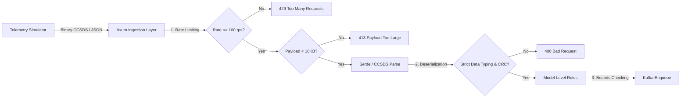

# OrbitLogs: Security Practices & Hardening Guide
### Version: v4.0.0 (Latest)

This document outlines the security controls, validation architecture, and infrastructure hardening practices implemented across **OrbitLogs**.

---

## 1. Input Validation & Ingress Defense

The API ingestion tier employs input validation policies to mitigate threat vectors like malformed telemetry payloads, buffer overflows, and SQL injection.

### Ingress Sizing & Rate Constraints
- **Rate Limiting**: Enforced at the network ingestion point to prevent denial-of-service (DoS) floods. Telemetry ingestion is rate-limited to 100 requests per second using an IP-partitioned token-bucket rate limiter via `DashMap`, returning `429 Too Many Requests` when exceeded.
- **Payload Max Limit**: HTTP payloads are limited to **10 KB** at the Axum layer to eliminate memory exhaustion attacks, returning `413 Payload Too Large` when exceeded.
- **Strict Parsing**: The Axum JSON parser rejects any extra fields or duplicate JSON keys (enforced using Serde's `#[serde(deny_unknown_fields)]` container attribute).

---

## 2. Authentication, Cryptography & Auth Guardrails

### Timing Side-Channel Defenses
To prevent timing side-channel attacks that leak secret keys, credentials comparison utilizes a SHA-256 pre-hashing comparison approach:
*   Credentials are hashed using SHA-256 first, ensuring both inputs to `ct_eq` are exactly 32 bytes, regardless of user input length.
*   Centralized in `spaceops-models::auth::secure_compare` ([auth.rs](file:///c:/Users/bikrams/orbitlogs/OrbitLOgs/crates/spaceops-models/src/auth.rs)).

### JWT-Based Command Permissions
*   Flight commands require a securely signed JWT Bearer token with Role-Based Access Control (RBAC) validations.
*   Roles (Operator, Flight Director, Administrator) restrict modification privileges.
*   HMAC signing secrets are separated from service API keys.

### LLM Prompt Injection Guardrails
*   The `ai-incident-commander` configures strict system prompt boundaries to prevent malicious operators from injecting inputs that dump database secrets or proprietary runbooks.

---

## 3. Network Transport Security & Container Hardening

### Mutual TLS (mTLS) Kafka Networking
*   Internal broker-to-broker and client-to-broker traffic is encrypted using mTLS.
*   Certificates are generated on boot by a local certificate orchestrator container (`certs-generator`).

### Container Isolation
*   Multi-stage container builds separate compilation dependencies from runtime packages.
*   Containers execute under a non-root system user `spaceops` (UID/GID 10001) to mitigate escape exploits.
*   Database passwords and keys are mounted from secure secret files at `/run/secrets/` rather than environment strings.
