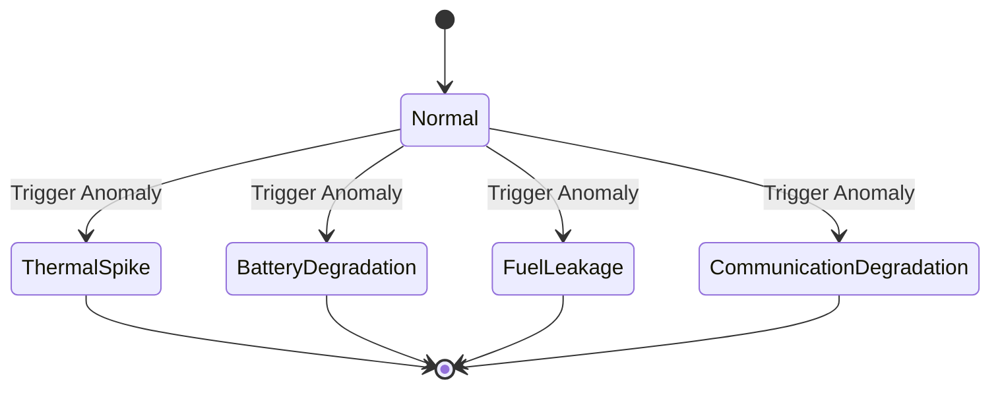

# OrbitLogs: Telemetry Simulator Design
### Version: v4.5.0 (Latest)

This document details the design specifications, scenario evolution state machines, and physics calculations of the **Telemetry Simulator** service.

---

## 1. Design Goals & Requirements

The Telemetry Simulator is built to:
- Generate realistic, time-varying satellite metrics (thermal cycles, EPS charges, attitude roll, orbital altitude).
- Run in **multi-threaded tasks** supporting arbitrary fleet sizes (1 to 5,000+ satellites) without thread starvation.
- Offer **reproducible simulations** (deterministic mode) to allow regression testing of downstream alerting systems.
- Inject mathematical anomalies representing complex orbital space anomalies (thermal spikes, solar charge drops, fuel line leakage).
- Encode streams into CCSDS-inspired binary format with CRC-16 check bytes.

---

## 2. Scenario Evolution Engine

Every simulated satellite maintains its own internal state machine, progressing over time-series tick intervals.

### Anomaly Mathematical Evolutions
1.  **Normal (SGP4 Orbital Mechanics)**:
    - Position (ECI Cartesian vectors), lat/lon, altitude, and orbital period are generated dynamically via the `sgp4` library mapping active TLE datasets.
    -sinusoidal phase cycles simulate solar panel battery charge cycles during daytime/nighttime orbits.
2.  **Thermal Spike**:
    - Simulates radiator/cooler failure. Temperature climbs exponentially:
      $$T_{\text{next}} = T_{\text{prev}} + 2.5 + \text{noise}$$
      (capped at $130.0^\circ\text{C}$).
3.  **Battery Degradation**:
    - Simulates charge exhaustion. Voltage drops linearly:
      $$V_{\text{next}} = V_{\text{prev}} - 0.15 + \text{noise}$$
      (minimum operating limit of $8.0\text{V}$).
4.  **Fuel Leakage**:
    - Fuel drops rapidly:
      $$F_{\text{next}} = F_{\text{prev}} - (1.2 + \text{noise})\%$$
    - Causes chaotic thruster pressure, which adds extreme noise to orientation pitch, roll, and yaw parameters.

---

## 3. Reproducible Determinism (Seeding)

To support integration testing where telemetry outputs must be 100% predictable:
- **Seed Input**: Users can pass `--deterministic` and `--seed <U64>`.
- **Satellite Seeding**: Each satellite derives a unique pseudo-random seed by hashing its `satellite_id` string and XORing it with the master seed:
  $$\text{Seed}_{\text{satellite}} = \text{Seed}_{\text{master}} \oplus \text{Hash}(\text{id})$$
- **RNG Type**: Uses the cryptographically secure and lightweight **ChaCha8** random number generator (`rand_chacha::ChaCha8Rng`).
